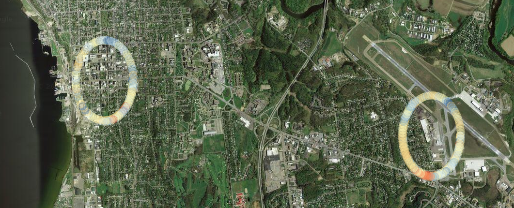

|  |
| --- |
|  |
| *Info-Vortex Over Burlington* |

Cartography has a well-earned but still-largely unrecognized reputation for messing with human perceptions of real phenomena. Got heathens on the other side of your national border? Just [shade them out and pretend they don't exist](http://en.18dao.net/images/e/ec/Map-Dominican_Republic.jpg). Want to make it seem like you're a global underdog? Show yourself [surrounded and menaced by powerful foes](http://www.mindserpent.com/American_History/foreign/germany/posters/map.bmp). This sort of crap makes cartography - and geography more broadly - look like something practiced by schemers in tophats and handlebar mustaches.
But manipulation of space is the bread and butter of cartography, stemming from some central questions: How do you make round things flat? How do you make the impossibly-large small enough to see on a canvas or on a glowing smartphone screen? Mapping inherently involves reduction and obfuscation, so the problem I recently came across is a novel one:
How do you expand an effect on a map?
When Hurricane Irene hit the U.S. Northeast, hundreds of thousands of people took to the Twitterverse (and to Facebook and traditional civil response agencies, not to discount them) to report damage and request help. A few thousand folks mostly in the NYC area sent their tweets with geolocation included. Good on them, but they represented somewhere in the neighborhood of 1% of the hurricane-related traffic. Tens of thousands more sent messages with placenames in the text, some more specific than others.
Modern geocoding services like [Google](http://code.google.com/apis/maps/documentation/geocoding/), [Yahoo](http://developer.yahoo.com/geo/placemaker/) and [Nominatim](http://wiki.openstreetmap.org/wiki/Nominatim) provide great geolocation based on addresses and fragments, but what happens when you've got a single placename representing a general area? What if it recurs thousands of times? Do you map everything at a single location, the centroid of a state boundary?
The word "Vermont" appeared in over 6,000 Twitter posts in the four days immediately after Irene washed through the state. With nothing else to add specificity, this means that over 6,000 events occurred at 43.8717 N, 72.4517 W: the geographic center of the state. While this is a bit whimsical, it still presents the problem of showing a huge number of unique messages at a single place.
<iframe height="400" src="https://geosprocket.cartodb.com/tables/ml_vt_locations_112311k/embed_map?sql=SELECT * FROM ml_vt_locations_112311k" width="670"></iframe>
A spiral seems to fit the bill; the points spill outward and occupy their own space, but they clearly originate from the central coordinates they share. It's not spatially exact, but it shows both association and information volume. Smaller spirals begin everywhere multiple posts share the same placename, for example in Rochester and South Burlington.
Using LibreOffice Calc (or Excel if you must) and [CartoDB](http://cartodb.com/), this visualization is actually a snap. It begins with a set of Twitter posts and Lat (Y1) & Long (X1) coordinates taken from placenames in the text (a service provided by [metaLayer](http://metalayer.com/) - more on that in the next posting).

1. Sort the table by unique location
2. Add fields representing:

1. Location-magnitude (i)
2. Bearing of spiral point (ang)
3. New Lat (Y2)
4. New Long (X2)

3. Calculate as follows:

a = 0.005

b = 0.009

i = if X1 is not unique

i + 1

else 0

ang = (Pi/45)\*i

Y2 = Y1 - (a \* SIN(ang)) \* (2.718281828 ^ (b \* ang))

X2 = X1 + (a \* COS(ang)) \* (2.718281828 ^ (b \* ang))

This may seem a bit obtuse, but it can be adapted to VBA, Python, JavaScript or whatever suits your purpose. And the 'a' and 'b' variables can be tweaked to make a spiral to your own specifications; 'a' controls the distance offset from the central point, and 'b' controls the rate at which the spiral expands. It works best if both are kept between 0.001 and 0.1. In any case, once the table has the new coordinates, upload it to your CartoDB account and render some tiles!

There are certainly a host of other ways to attack this problem, but a spiral is a basic solution in a world where crowdsourced data increasingly muscle into the geographic sphere, begging to be placed on a map.
