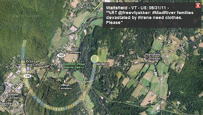

Place is powerful in a crisis.
Place brings the responder to the emergency. Place measures risk and damage. Place is often the most important piece of situational context, particularly when a hurricane takes a wrong turn on the New Jersey Turnpike at the end of an otherwise-unremarkable August.
Crisis maps were invaluable in the reaction and recovery surrounding the drunken lope of Hurricane Irene up the eastern seaboard a few months ago. The rapid deployment of tools like [Ushahidi](https://vtirene.crowdmap.com/main), [Tweak the Tweet](http://www.cs.colorado.edu/~starbird/TtT_Irene_map_byEvent.html) and [#VTResponse](http://vtresponse.wordpress.com/) created a centralized, crowdsourced voice for the crisis. [Google's Crisis Landing](http://crisislanding.appspot.com/?crisis=2011_flooding_vermont) was used to augment the capabilities of local, state and federal agencies as they organized reports of damage and assessed priorities, disseminating the information directly to the public. [Patrice Cloutier has exhaustively documented the crowdsourced Irene response in [this report](http://www.scribd.com/doc/69178713/HurricaneIrenesocialmediaAAR-v2)] All of these tools involved a place component -  "Where is this happening?", "Where is this needed?" - and could draw on semi-precise geolocation assets like online address searches and smartphone GPS sensors.
However, there was also a huge dialog occurring without real geolocation, on Twitter, Facebook and any number of smaller social media outlets. These messages numbered in the hundreds of thousands, but on their own were lacking the context of place.
This is where new developments in "Big Data" analytics come in handy. With some computational heavy lifting from [Kate Starbird](http://twitter.com/katestarbird) at the University of Colorado and [Chris Danforth](http://onehappybird.com/) at the University of Vermont, Geosprocket was able to bank millions of Twitter posts from the days surrounding the storm. Then the assistance of [metaLayer Inc.](http://metalayer.com/) was instrumental in putting Irene-related tweets on the map. Using a series of digital sifting processes, they were able to mine the archived Twitter data for placenames and keywords. Where a town or street name was included in a post, that post could be placed at a set of geographic coordinates. Were words like "washout" and "devastated" were used, fine-tuned algorithms could assign a scaled value for the sentiment of the post.
Add a bit of cartographic styling and serving with the open-source [MapBox](http://mapbox.com/) toolkit, and we've got [an interactive mapped timeline of Hurricane Irene, as told by Twitter:](http://dev.geosprocket.com/vtirenecarto.html)

No analysis of this type is going to be perfect - the data is inherently messy, noisy, inconsistent - but now that the storm is long past this kind of view can tell us a lot about how we responded to the crisis. It can give us ideas for preparedness. And as platforms like [metaLayer](http://metalayer.com/db/) and [Swiftriver](http://ushahidi.com/products/swiftriver-platform) become more robust, we can apply the power of place and more in real-time when the next crisis hits.
