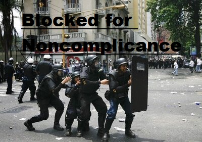

While I'm aware that dystopian fiction is more the field of Newt Gingrich, I had a few thoughts today as the SOPA/PIPA battle continued to rage across the interwebs and traditional media both. You see, I'm a cartographer, and visualization is my stock in trade. As a cartographer with a particular interest in [Crisis Mapping](http://crisismappers.net/), I realized that the bills now before the House and Senate could have some as-yet-unexplored consequences. Let's explore some of them:
\*\*\*\*\*\*\*\*\*\*\*\*\*\*\*\*\*\*\*\*\*\*\*\*\*\*
January 19th, 2014

- At 8AM, the shelling begins in [Acarigua](http://g.co/maps/ub62c). Venezuelan government forces are trying to push their way into the center of the city, where pro-devolution demonstrators had clashed with - and ultimately expelled - the federal police the previous day. Now, as the troops begin to retake Acarigua block by block, panicked residents scramble for cover while others erect barricades on the main streets.
- Eustacio Torres was living in Pittsburgh on a guest worker visa when the news arrived that Acarigua had rebelled against federal Venezuelan control; he was immediately worried for the safety of his mother, who still lived there. At 9:10AM, [some mobile phone providers'](http://www.movistar.com.ve/particulares/) lines are jammed with traffic and [others](http://www.movilnet.com.ve/sitio/) have obeyed a shutdown order issued by the government. Eustacio is not alone in his concern; thousands of others in Venezuela and beyond are looking for news from
  Acarigua.
- At 9:15AM, Belen Diaz - a software developer in Bogota - registers the domain name *ataqueacarigua.org.co* and hosts it to her server on a local ISP. She deploys the [Ushahidi crisis monitoring platform](http://ushahidi.com/) and attaches it to that domain. By 9:55, after some calls to news organizations and social media outlets, the site begins to see significant traffic. Hundreds of users post updates and comments as news appears. A small but key number of reports filed to the site come from residents of Acarigua, sent by SMS on the spottily-available signals to a dedicated shortcode registered by Belen.
- At 11:43AM, a freelance journalist working for News Corp. takes 17 seconds of footage showing soldiers firing live rounds on a group of apparently-unarmed young men in Acarigua. Unseen in the confusion, he manages to quickly offload the footage to [New York](http://www.social42.com/organization/Fox-News-Headquarters/45497) via satellite uplink.
- At 12:34PM, as the shelling tapers off and automatic weapons can be heard closer by, Anamaria Torres asks her nephew Jaime to call her son Eustacio, saying that she's safe for the moment but scared. Jaime tries, but can't connect the international call. He then posts the message by SMS to the Ushahidi shortcode. The message reaches *ataqueacarigua.org.co.*
- At 1:12PM, Belen sees the message posted by Jaime, marks it as plausible but unconfirmed, and posts it to the site for all to see.
- At 1:14PM, Jacob Crenshaw in Dallas sees a grainy clip of soldiers firing on civilians in Acarigua, as part of a Fox News analysis segment. He records it off the TV with his phone camera and uploads the footage directly to *ataqueacarigua.org.co*. A volunteer working with Belen sees it and posts it to the public view.
- At 1:56PM, a Fox web technician is alerted to the unauthorized rebroadcast of footage on *ataqueacarigua.org.co*. The News Corp. copyright-dedicated legal team submits an urgent takedown request to the U.S. Justice Department. The A.G.'s SOPA-compliance division grants the request, noting that the appropriate boxes are checked to meet the burden of proof and that the paperwork is in order.
- By 3:45PM, the domain *ataqueacarigua.org.co* has been blocked and all search engines have removed it from their listings. Attempts to broadcast the direct IP address are similarly blocked and sites sharing it are added to the injunction.
- At 5:22PM, reports are still coming in to the server, but less than 5% of visitors are able to view the site.
- At 6:40PM, Eustacio is able to access the internet using a friend's laptop. There is no communication from his mother, and the front page of *ataqueacarigua.org.co* reads ["This domain has been blocked pending legal action as per the provisions of H.R. 3261, the Stop Online Piracy Act" . . .](http://drew3000.net/wp-content/uploads/2012/01/SOPA-content-blocked.jpg)

\*\*\*\*\*\*\*\*\*\*\*\*\*\*\*\*\*\*\*\*
So this is nuts, right? But I've grown a bit weary of hearing that SOPA and PIPA will "Only impact foreign sites dedicated to infringment." [Many of us work](http://wiki.openstreetmap.org/wiki/Humanitarian_OSM_Team) [across borders](http://www.geosprocket.com/), and our world is interconnected in ways that our Congress doesn't seem to understand. But more specifically, does anyone believe that the Justice Department will get right on SOPA compliance requests with lots of funding and an adequate staff? Or that they won't be carroted and sticked into pro-forma approval of most requests the same way [the major banks bulldozed the OTS](http://www.reuters.com/article/2008/07/11/us-indymac-schumer-idUSWA000014220080711) in the run-up to the 2008 economic crash?
These bills are a real threat to freedom, at home and abroad. We should be concerned about both. This has been a whimsical case study, but it's because these bills show a lack of imagination.
