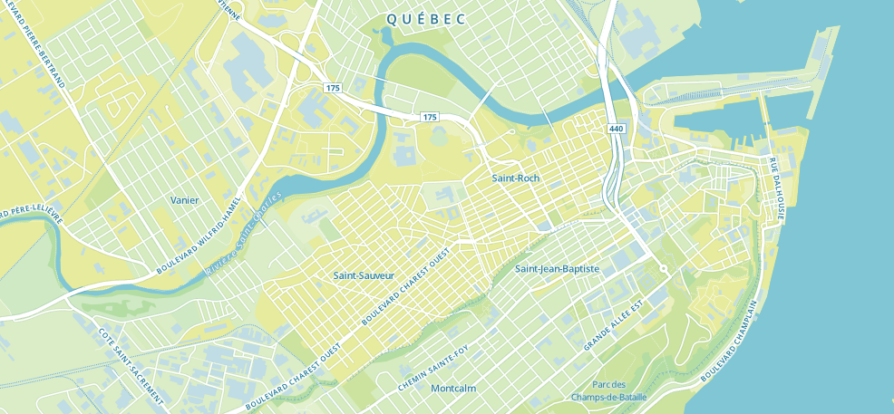

So this O'Reilly chap evidently has [some soiree planned](http://whereconf.com/where2012) every year this time, somewhere on the West coast. In the past, I've been able to blithely ignore the proceedings and hope that someone else would eventually point me toward anything useful that arises. Basically the same attitude I have toward SXSW.
Regrettably, this year I'm being forced to perk up from my West-coast-of-New-England-afternoon-coffee stupor and pay the hell attention. Three items caught my eye on Twitter today and yesterday:
1.) [Custom cartography for Mapbox Streets](http://mapbox.com/blog/custom-styles-mapbox-streets/) - The [Development Seed](http://developmentseed.org/) team clearly proceeds from day to day in a Red-Bull-fueled tornado of productivity. They've caught on that the momentum is away from the ubiquitous Google Maps API and base layers, and they're doing everything they can to offer a replacement for the whole stack. In particular, they've done Google one better here on cartographic quality. MapBox's [OpenstreetMap-based tiles](http://mapbox.com/maps/) are uniquely beautiful, and sufficiently-varied that we users might now be able to escape the homogenization of web map styles over the past few years (Yes, Microsoft, even your basemaps look a lot like Google's). Cartographic design just won big. Here's some Tilemill-styled twitter data of mine over the new Mapbox "Lacquer" Base tiles:
<iframe frameborder="0" height="400" src="http://a.tiles.mapbox.com/v3/landplanner.map-oq916k6k.html#7/42.964/-71.517" width="660"></iframe>
2.) [Foursquare has a new geocoding engine](https://github.com/foursquare/twofishes) - Saints be praised, another way to escape Google. I don't yet know how solid Foursquare's placename database - called TwoFishes- will be for everyday applications. However, my current reality has me [tethering whole projects to the GMaps API](http://dev.geosprocket.com/nrel.html) specifically because the Google geocoder is the only one to consistently find the correct location when a user searches for an address. I need alternatives, and they are particularly welcome from a company that is already showing a dedication to open geodata.
3.) CartoDB murders the middle of the GeoStack - The team at [Vizzuality](http://vizzuality.com/) has been intimidatingly-busy as well. Though it may have been overlooked in the WhereConf hoopla, yesterday they teased out a project called [VECNIK](https://github.com/Vizzuality/VECNIK); at the moment it consists of a series of HTML5-ready libraries for [fast vector styling directly in the browser](http://vizzuality.github.com/HTML5-experiments/d3/US-county-area.html). This includes pulling the parsed vector from the already-smooth CartoDB SQL API, compiling a stylesheet in the super-flexible [Carto language](http://mapbox.com/tilemill/docs/manual/carto/), rendering the whole thing with Mapnik and serving it into the [ModestMaps library](http://modestmaps.com/) - entirely in the browser. This happens at speeds that ten months ago would have been achievable only with cached tilesets. As with basically everything Vizzuality does, it's going to take me a few more months to grasp the full implications of this advance; I'm psyched enough for the moment though. Here's an example showing "Hand-sketched" parcel boundaries in my neighborhood (Modern browser required):
<iframe frameborder="0" height="400" src="http://dev.geosprocket.com/btv_sketch.html#16/44.5055/-73.2627" width="660"></iframe>
So to anyone else who's planning to drop major innovation bombs on the GeoSpace at WhereConf, $#@%in' stop. I've had enough for this week. Don't even get me started on [PostGIS 2.0](http://postgis.refractions.net/news/20120403/). Save it for [FOSS4G-NA](http://foss4g-na.org/) in D.C. next week, by which time I hope to have recovered enough spare neurons to take it all in. See you there.
