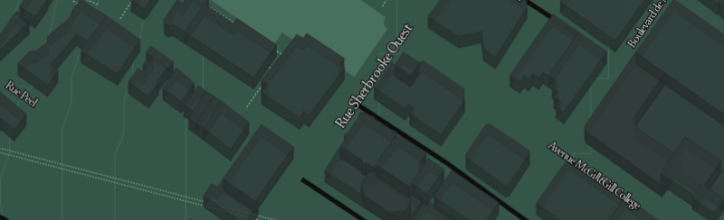
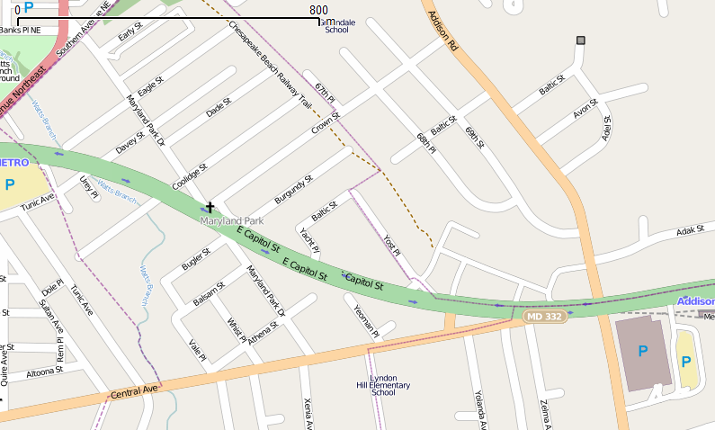
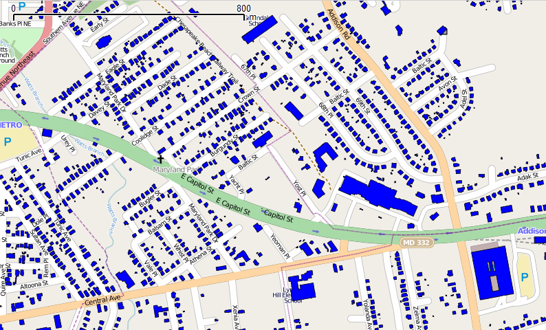

I like building footprints. As a cartographer, I find that they bring important context to a certain scale of map. In the same way that I look for patterns and paths in the contour lines of a national park, I see explanations of how we live and work in the layout of buildings in a city. [Basemaps for the web applications I write](http://btv.geosprocket.com/#17.00/44.48244/-73.20653) always benefit from having structures as a ground reference.
Over the past few weeks I've been working to add about half a million building footprints to OpenStreetMap, mostly in the Mid-Atlantic region of the United States. The excellent data is the result of [years of work](http://bit.ly/GIszsg) - ongoing in many sites - by the [Spatial Analysis Lab at the University of Vermont](http://www.uvm.edu/rsenr/sal/index.html). They've fused LIDAR data with multispectral aerial imagery in an object-based classification of land use for their client municipalities, and they're happy to offer the results to the OSM open license.
Here's the current OSM Mapnik render in Maryland Park, just outside of D.C. -

And here's the same area with UVM-SAL building footprints added -

I've been careful to discard footprints that overlap with an existing OSM line or polygon feature, since user-traced content takes priority over bulk imported content. But [having taken this data to the OSM community](http://lists.openstreetmap.org/pipermail/talk-us/2012-April/007748.html) for review, I am now aware that it's a complicated thing to "Add data" in bulk to a crowdsourced database. Users have eloquently argued both [for](http://lists.openstreetmap.org/pipermail/talk-us/2012-April/007755.html) and [against](http://lists.openstreetmap.org/pipermail/talk-us/2012-April/007749.html) the import of these building footprints, and I find it boils down to a pair of inextricably-linked perspectives on OSM:
1.) OpenStreetMap is a community of individuals. The interaction between the user and the map is most valuable when one user "owns" their offering, and a dozen building-footprint-tracing contributors from Baltimore will feel greater ownership of their neighborhood than one guy in Vermont who uploads the whole county in one batch.
2.) OpenStreetMap is a tool. It is becoming a [basemap of record](http://www.nytimes.com/2012/03/20/technology/many-sites-chart-a-new-course-as-google-expands-fees.html) in the GeoSpace precisely because that's what we wanted to do with it. OSM competes admirably with proprietary datasets, and we can use it for [beautiful cartography](http://maps.stamen.com/#watercolor/14/47.6134/-122.3178) and [complex analysis](http://www.sciencedirect.com/science/article/pii/S0198971510000402). Any scale of addition is valid, as long as it is offered on the same open license.
The question that lies between these two perspectives: Can we have a quality basemap while maintaining a strong commitment to individual user engagement?
I think the answer is yes. I'm going to proceed with my buildings import on an assumption that was [echoed by Kate Chapman](http://lists.openstreetmap.org/pipermail/talk-us/2012-April/007764.html): If a user in Bethesda finds that the buildings in her neighborhood are "already there", maybe instead of losing a sense of ownership she'll take it to the next level by adding identities to those structures.
Because I'm just adding the outlines. I can't tell you which one of them is a Bodega. There are many layers of value yet to be added.
