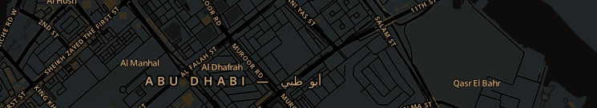
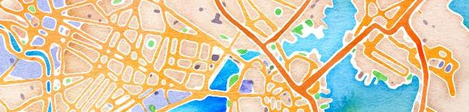

I had the good fortune to make it to this year's iteration of the [Free and Open Source for Geospatial](http://foss4g-na.org/) (FOSS4G) tech conference - North American edition (other sections of it will be occurring in Germany and China). Having missed the [O'Reilly festival of place](http://whereconf.com/where2012), it was a great opportunity to catch up with - as one attendee put it - "The real makers in the world of maps". [Sorry, ESRI, you've actually been standing in the way of cartographic explanation for about a decade now]
While there was more afoot than I could ever have followed entirely, I took note of two items:
1.) People are really jazzed about PostGIS. Core architect Paul Ramsey kicked off what would be three days of love for the [new release](http://postgis.refractions.net/news/20120403/) (version 2.0), and we were treated to all sorts of examples on how you can use it. Raster support, TileMill optimization, simple SQL strings replacing reams of jagged python for geoprocessing workflows - the possibilities seem endless.
I really like that such a great, extensible project is at the heart of open-source geographic technologies, but I still feel left out of the party. Basically, I am intimidated by the first hurdle of PostGIS: PostgreSQL at the command line. This is not that big of a deal for true developers, but I've been repeatedly burned by the wonkiness of database administration, permissions and security in postgres. Once I can get to the actual SQL, the birds start singing, the sun comes out and the world is full of possibilities, which is what makes client-focused tools like [CartoDB](http://cartodb.com/) and [QGIS](http://www.qgis.org/) so enjoyable.
2.) Web maps are the home of cartographic design now. This may have been the purview of National Geographic even five years ago, but static maps are lacking the possibilities laid out - for example - by [AJ Ashton](http://dl.dropbox.com/u/2398828/aj_ashton_foss4gna12.pdf) and [Nathaniel Von Kelso](http://kelsocartography.com/presentations/2012/nvkelso_foss4g_na_2012.pdf) in sessions that touched on using [OpenStreetMap](http://www.openstreetmap.org/) as both art and function.

|  |
| --- |
|  |
| [MapBox "Lacquer" Tiles](http://mapbox.com/maps/) |

|  |
| --- |
|  |
| [Stamen "Watercolor" Tiles](http://maps.stamen.com/#watercolor/13/42.3662/-71.0094) |

Take this with a word of warning issued by Schuyler Earle during a panel session: Software developers think they are natural designers. They're not. They need to hire designers, who can - like sober friends at 2AM - shepherd us away from bad decisions. Users will benefit if we can all get a design perspective on "I think this thing needs another button on the sidebar" before we act.
Many thanks to the organizers of FOSS4G-NA. It was a rockin' good time, full of productivity and great encounters. And for those who need a lingering shot of natural-disasterage, here is my ignite talk from the first night. Heavy on pictures, low on explanation, much the way it should be:
