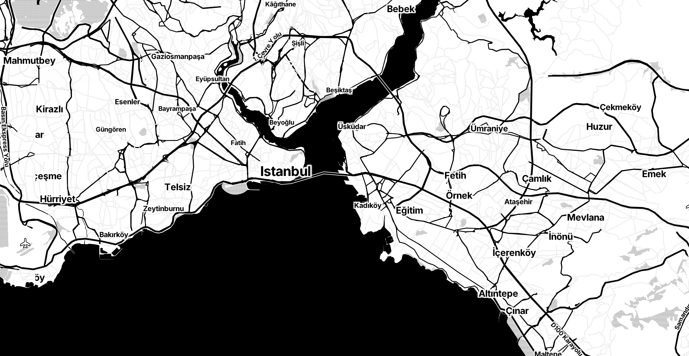
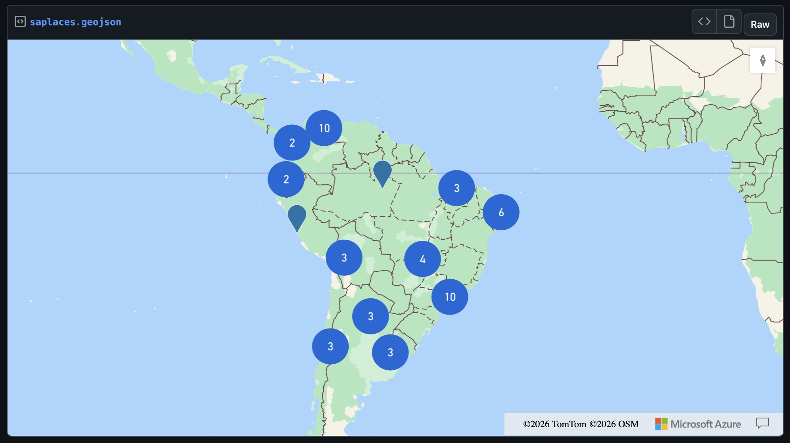
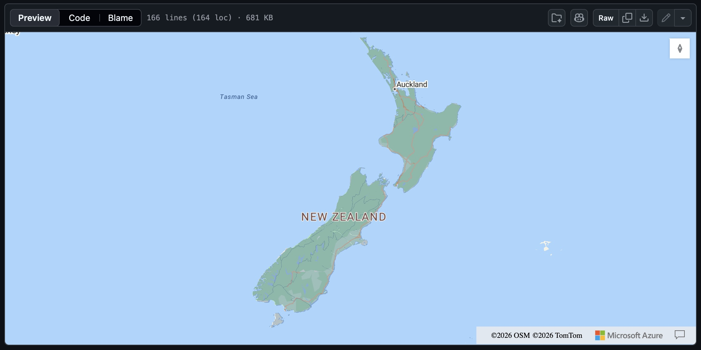

Hear me out for a minute . . .

*"Toner" tiles by [Stamen Design](http://maps.stamen.com/#toner/12/37.7706/-122.3782)*

. . . **I'd like you to make maps intended for online viewing.**
This is partially a selfish impulse; I'm going to throw a rock through the window if I see [another "PDF Download" link](http://www.sfbike.org/download/SF_Bike_Map_2011.pdf) masquerading as a web map. I'd also like you to do this to save a few trees from their 24"-by-36"-poster fate, but mostly it's because we're at an inflection point in cartography . . .

<iframe frameborder="1" height="150" marginheight="0" marginwidth="0" scrolling="no" src="http://maps.google.com/maps?f=d&amp;source=s_d&amp;saddr=Archibald+St&amp;daddr=The+Home+Depot+-+Williston,+Harvest+Lane,+Williston,+VT&amp;hl=en&amp;geocode=FU7UpgId0Nqi-w%3BFeoepgIdRkyk-yFJl0EuThOGAinjx4-u5HjKTDGQaBw1U1xL8A&amp;aq=0&amp;oq=home+depot&amp;sll=44.472054,-73.202802&amp;sspn=0.056409,0.067291&amp;t=w&amp;gl=us&amp;mra=ls&amp;ie=UTF8&amp;ll=44.463405,-73.16281&amp;spn=0.04935,0.10084&amp;output=embed" width="100%"></iframe>
[View Larger Map](http://maps.google.com/maps?f=d&source=embed&saddr=Archibald+St&daddr=The+Home+Depot+-+Williston,+Harvest+Lane,+Williston,+VT&hl=en&geocode=FU7UpgId0Nqi-w%3BFeoepgIdRkyk-yFJl0EuThOGAinjx4-u5HjKTDGQaBw1U1xL8A&aq=0&oq=home+depot&sll=44.472054,-73.202802&sspn=0.056409,0.067291&t=w&gl=us&mra=ls&ie=UTF8&ll=44.463405,-73.16281&spn=0.04935,0.10084)

*Routing application with [Google Maps](https://maps.google.com/)*

. . . I think the public - the folks who show up to input forums for development projects, and who want to know how far it is to the next lean-to on the trail - are now fully-literate in maps. [Mapquest started this process and Google advanced it](http://blog.agitcraft.com/2010/12/design-study-mapquest/), but now there are tools beyond those to help you engage your audience on computers and mobile devices (No, Trimble, I am not referring to the Juno. Screw that.). Many of these tools happen to be open-source . . .

*Ecoregions of New Zealand, hosted by [Github](https://github.com/wboykinm/geosprocket-geodata/blob/master/nz-ecoregions.geojson)*

. . . If you currently describe yourself as a "GIS Analyst/Technician/Monkey" - as I did not long ago - your day largely consists of desktop GIS, and 95% of you are working entirely with some combination of ESRI products. I frequently slag ESRI for bugginess and closed-ness, but they do just fine making a desktop platform for geospatial analysis. However they have never known what "Cartography" means (that's right, you take it to Illustrator if you want your map to look good), and they're just starting to realize that they don't know what "Web Mapping" means either. . .

*Population Change in South American Cities, [in a gist](https://gist.github.com/wboykinm/8717248)*

. . . The "open-source alternatives" are not replacements for ArcGIS. But through advances in cartography and and browser-based distribution, open tools are unearthing the truth that the rest of us forgot about while sorting through ArcToolBox: that maps tell stories. That your data can be weighted, decoupled, buffered and regressed twenty ways and it means nothing if your cartography is crap. That you can drop cash on a printed poster with a sweet imagery background and it's lost to the ether if two people show up to your hearing, then you post it publicly as a PDF.

These are issues that bedevil public and private sectors, academic and amateur alike. But I say that you can make accurate yet artistic maps and deliver them in a way that is almost universally accessible (at least in the developed world). Let's make maps that people care about.

With the 'Why' of it behind, [my next post will be an introduction to the 'How.'](https://billmorris.io/shoals/gis/cartography/2012/05/30/browser-cartography-some-safehouses-for-esri-refugees.html)
