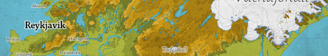
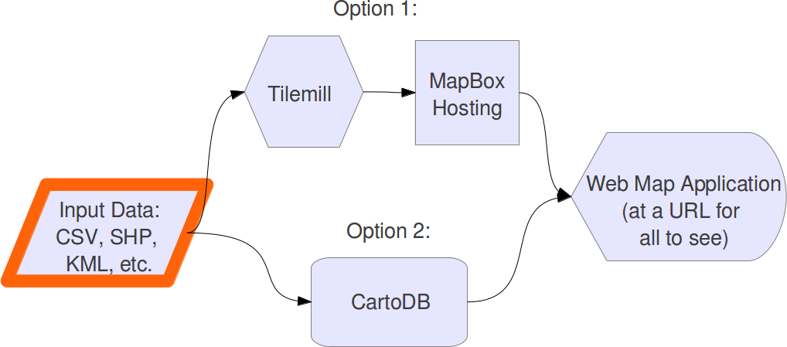
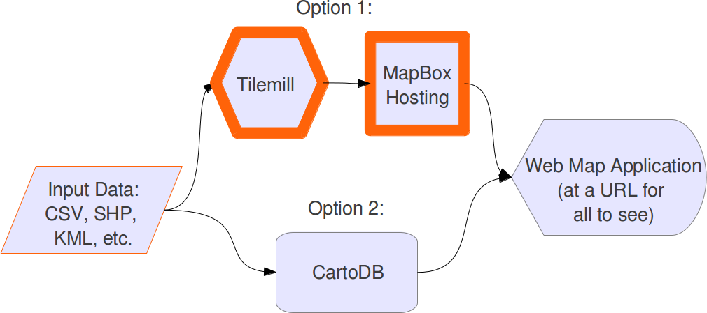
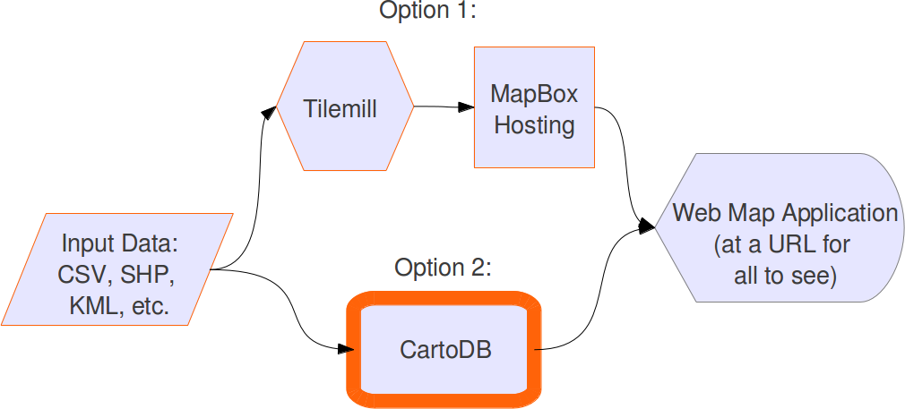
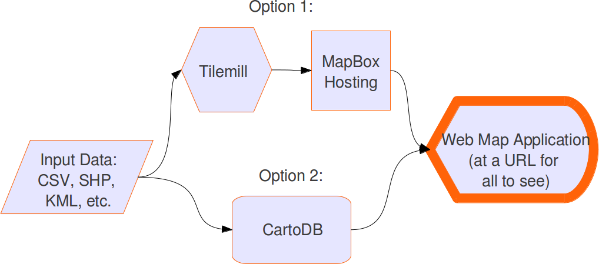

*["Island"](https://tiles.mapbox.com/kkaefer/map/iceland) by Konstantin Kafer*

## A Primer for Getting Started With Open-Source Web Maps

Now that you know [why I care](http://geosprocket.blogspot.com/2012/05/browser-cartography-manifesto.html) about telling compelling stories with widely-distributed maps, let's look at a few of the many tools that are out there to help the process. I confess to narrow experience here; I use [MapBox](http://mapbox.com/) and [CartoDB](http://cartodb.com/) for the majority of my projects, and there are plenty of alternatives to those. But as a starting point I think that these open-source web map design platforms are perfect - they minimize the amount of code required, they use the [best graphic rendering engine in the field](http://mapnik.org/), and they are extremely cheap (or free) to use, even in an enterprise or high-traffic environment. I'm avoiding ESRI's "ArcWhatever Online for Server" options because of a.) [the high price tag](http://spatiallyadjusted.com/2012/06/14/arcgis-online-pricing-released-whats-a-service-credit/), and b.) the [actual user-facing sites](http://gis.cityofboston.gov/SolarBoston/#) are only as robust as the javascript or flash developer who builds them. My preferred options give you a lot more to work with out of the box, for free.
I am not going to walk you step-by-step through the process below - I'll point you to resources that will - but rather I mean to sketch the structure that can get your map applications up and running. If you're stumbling and need some help, drop me a line through the [GeoSprocket contact page](http://www.geosprocket.com/core/index.php/contact/) or on [Twitter](https://twitter.com/#!/vtcraghead)

### Step 1: Data

Data in this context can mean a lot of different things. The tools we're using aren't picky, so this includes:

- Shapefiles (but this will need to be in a compressed folder)
- Spreadsheets (CSV, XLS, DBF, you name it)
- KML or KMZ
- GPX or in many cases raw text from various GPS units

Desktop GIS isn't dead. Those who say so aren't paying attention. You still need some form of spatial data manipulator to analyze and prepare your source information, and if you can do that with pure GDAL hacking at the command line of a virtual machine, you have no need for my advice. Yes, "Desktop Platform" includes ArcMap, but if you want to make a clean break I recommend [Quantum GIS](http://qgis.org/) for robust, open-source geoprocessing potential.

### 

### Step 2: Choose a Platform and Get a Hosting Account

Your data should live on the web somewhere - where, exactly?

- Option 1: MapBox - Most advantageous for its speed and complete cartographic design potential. However, once you've rendered your map into tiles (in step 3), there's not much you can do to change them on the fly. Use this option if you have a specific vision of symbology in mind to present to your users, if you have a lot of information to present interactively (i.e. text/charts/images that pop up when a feature is clicked), and also if the underlying data will be accurate for more than a few weeks. [Sign up here](https://tiles.mapbox.com/signup/free) for the free starter account.

- Option 2: CartoDB - This is a user-friendly, cloud-based adaptation of the popular [PostGIS](http://postgis.refractions.net/) database architecture. It can run a bit slower than MapBox (since it's rendering on the go), and the cartography options are more limited. However, the provided SQL API means that you can sort, filter and process your data basically in the browser. Go with this option if your application will have a lot of user-generated queries (i.e. "how many points are within 50 miles of this one?"), or if you regularly update the data being mapped. [Sign up here](https://cartodb.com/signup) for the free starter account (notice the pattern of freeness).

### 

### Step 3: Mapping Your Data

- Option 1 is a two-step process; first you style your map using the open-source design platform TileMill (download and install it [here](http://mapbox.com/tilemill/)), then you upload the resulting set of tiles to a hosted account (you signed up in step 2, but note that the [hosting program is also open-source](https://github.com/mapbox/tilestream) if you prefer to manage the hosting on your own machine). [Much digital ink has been spilled](http://www.wired.com/gadgetlab/2010/09/mobile-devices-need-custom-maps/) on the capabilities of TileMill, and the [tutorial documentation](http://mapbox.com/tilemill/docs/crashcourse/introduction/) is excellent. The process can be characterized as:

1. [Data Import](http://mapbox.com/tilemill/docs/crashcourse/point-data/)
2. [Visual Design](http://mapbox.com/tilemill/docs/crashcourse/styling/)
3. [Interactivity](http://mapbox.com/tilemill/docs/crashcourse/tooltips/)
4. [Export to Tiles](http://mapbox.com/tilemill/docs/crashcourse/exporting/)

- Option 2 is relatively simpler to implement. [The documentation is also solid](http://developers.cartodb.com/documentation/using-cartodb.html), but the mapping portion can be broken down to essentially 2 steps:

1. [Data Import](http://developers.cartodb.com/documentation/using-cartodb.html#managing_tables)
2. [Styling for Display](http://developers.cartodb.com/documentation/using-cartodb.html#section-4)

At this point using either option, you should now have maps that are ready to be launched.

### 

### Step 4: Serving Your Map to the World

**Step 4a: Embedding** - By far the easiest way to get a URL that you can distribute to your audience. Both [Mapbox](http://mapbox.com/hosting/embedding/) and [Cartodb](http://developers.cartodb.com/documentation/using-cartodb.html#section-7) have fantastically-easy embed interfaces for plugging maps into your blog or website content management system, and in each case they essentially host a full-page map website for you as well. Examples:
<iframe frameborder="1" height="300" src="http://a.tiles.mapbox.com/v3/landplanner.map-610hwag3.html#13/44.487/-73.192" width="100%"></iframe>

*Racial Breakdown of Census Blocks in Burlington, VT Using Mapbox*

<iframe frameborder="1" height="300" src="https://geosprocket.cartodb.com/tables/parmap_122111/embed_map" width="100%"></iframe>

*Participatory Farm Mapping in Vermont with CartoDB*

**Step 4b: The World of Pages, Javascript** **and Beyond** - This creeps a bit further beyond the scope of what I hope to cover here, but this is the ultimate destination for most of my [map](http://twit.geosprocket.com/politik/) [applications](http://www.geosprocket.com/). There is simply greater flexibility in a website or mobile application that you can manage yourself, though it requires some knowledge of HTML, CSS and Javascript.
I say "some" knowledge - I didn't know the first thing about code when I got into this world, but it was amazing how easy it was to adapt a little bit. The resources available in the open-source software community are spectacular; the help and guidance offered to me by experienced developers out of sheer goodwill has been uniformly superior to the high-priced support of proprietary vendors (Trimble and ESRI, I'm looking at you). I am no developer, but with community help I've been able to explore and utilize some of the most exciting tools available to cartographers in our time. And things are only getting better from here . . .
Here are a smattering of places to start for customizing a page of your own:

- [Mapbox Templates](http://mapbox.com/map-sites/) - these require a bit of [github](https://github.com/) knowledge, but otherwise they are as close to plug-and-play map sites as you'll find.
- [CartoDB Examples](http://developers.cartodb.com/examples.html) - Plenty of code available for re-purposing and adapting. In many cases this just involves changing a line or two to point to your own data.
- [Codecademy](http://www.codecademy.com/#!/exercises/0) - Might as well learn how to do this stuff for real . . .

### Addendum: Playing the Field

These are not the only platforms out there by any stretch. I previously mentioned alternatives, and they are impressive as well. Here are three of the best, along with my caveats:
*Update 7/12: The third option on this list just got snapped up by ESRI. Bully for them buying a great  resource, but I haven't heard a thing about integration with ArcGIS online. Which makes me fear for a very talented team and some very cool applications . . .*

- [Google Maps](https://developers.google.com/maps/documentation/javascript/tutorial) - the innovator in this field, Google still provides the best imagery base layers, an intuitive javascript API, lightning fast speed and more features than you will ever use. The downside is the $10,000-a-year price tag for applications that cross some very low use thresholds (e.g. a modest number of hits or a password-protected deployment).
- [OpenGeo](http://opengeo.org/products/suite/) - this is an open-source (unlike Google's) database-to-client stack of tools that have been around almost as long as maps have been on the web. You can bend these components into just about any imaginable mapping purpose, and this has provided the backbone to some [high-profile projects](http://www.broadbandmap.gov/technology). Unfortunately, operating the stack yourself is code-intensive on both the DB and the client side, and the company's services are fairly expensive.
- [GeoCommons](http://geocommons.com/) - Possibly easiest to use of any of the options, this web platform has some basic geoprocessing capabilities and a dedication to social engagement. I use it only infrequently because the [really useful "GeoIQ" features](http://www.geoiq.com/products/geoiq-connect) are socked behind a paywall, and the free version suffers from a few bugs.

P.S. this post has not been an exhaustive look at cartographic storytelling in 2012. Had it been that, I would have spent 90% of it talking about the importance of outreach and distribution. People don't visit your map unbidden, and as such you should spend the majority of your time getting the word out. It's just fortunate that web maps are easy to distribute in these connected times.
