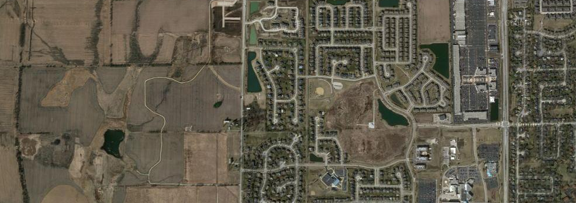
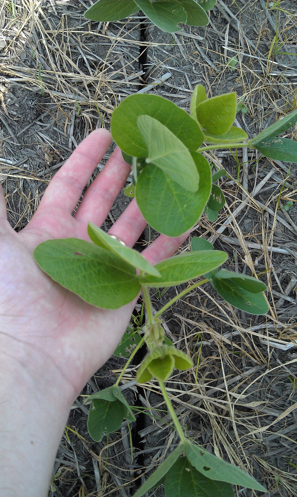
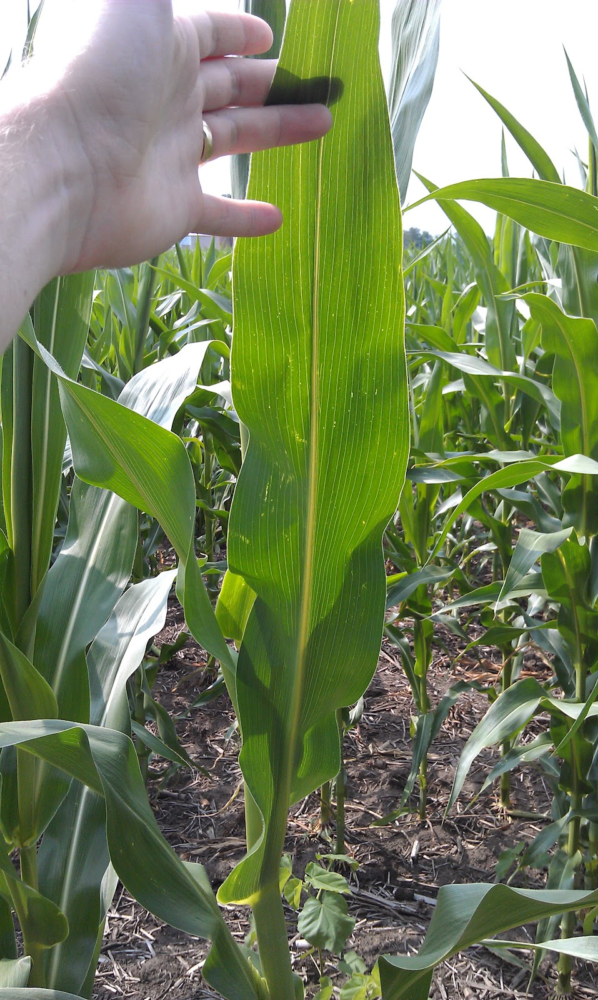
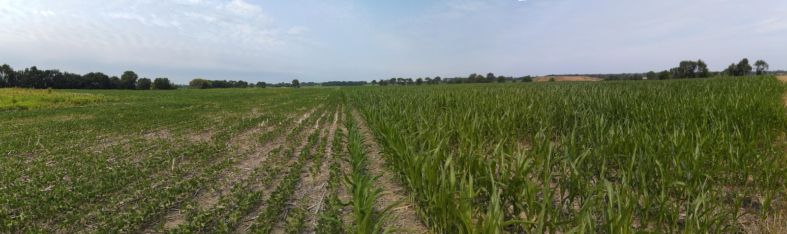

The day following my cousin's wedding in Geneva Illinois, I climbed into my rental car and cruised West a few miles. I had some time before my flight back East and realized I didn't know what a real cornfield looked like. Not from the ground, anyway. Though I'm working on a PhD in agricultural remote sensing, I spend my days analyzing crops from a vertical perspective of several hundred miles up - from high-resolution satellite instruments that can tell me a lot about cultivation patterns, vegetation health and potential crop yields. I can do this without leaving my office, and the Vermont landscape where I've lived most of my life is a hilly mosaic of field and forest. The largest corn plot in my neck of the woods is about 50 acres.

Where I was in Illinois, on the other had - seen from the air - could be plausibly called the start of the cornbelt. It's where the Chicago exurbs come to a surprisingly-abrupt halt and are replaced by a gradient of endless agriculture heading to the rockies - first the large grains, then wheat and hay, then rangeland, and not a lot of people. So I went to have a look. It only took a few minutes' drive to get beyond the housing developments and among some of the broadest agricultural expanses I'd ever seen live. I pulled off the road at one spot that looked fallow - like I could walk freely there - and got out of the car.

|  |
| --- |
|  |
| The line is drawn outside of Geneva, IL |

10AM and already over 90 degrees, it was not a hospitable environment for a northern desk jockey. But shimmering just beyond the fallow was an easy 500 acres of cultivated land, split evenly between recognizable corn and alien-to-me soy. Flat as the griddle before the pancake batter hits it. I broke a sweat and trudged out into the fields.

A few things were noticeable. First that the fringes of the field had smaller plants; this is nothing unique to the midwest, and usually due to some tricks of drainage and fertilizer-scattering angles. But the corn plants suffering on the edges here were still twice as tall as the healthiest of those I'd seen the week before in Massachusetts, burdened by draught upon heatwave upon hail upon late frost. The soy plants here I at first mistook for some monstrous cover crop, with leaves like clover growing a foot up out of the ground.

|  |
| --- |
| |
| Soy |

|  |
| --- |
|  |
| Corn |

There were distinct drill-planting scars in their rows, cracked wider in the heat and the dry. The two crops ran into each other in a perfect line, like allied brigades marching in formation rather than opposing armies that have crashed together. In most of the country outside of the Northeast, corn and soy are planted in an annual rotation. They both serve as cattle feed and compliment each other - soy brings nitrogen to the top soil horizon for the corn to thrive on the following year. The scattered cornstalks serve as fertilizer and mulch for the soy sprouts the year after that. On and on, with fallow making its way into the lineup less and less frequently.

I stooped to take some pictures of the rows, and I held a soy plant in my hand. The heat was impossible. I felt myself wilting, desiccating with no shade in sight. The leaves of the plant, however, were thick and healthy, bouncing a bit in the breeze. The robust copse of the stalk was covered thickly with a soft, spiny fuzz, and a few flowers were just peeking out of their exploratory growth. The corn as well seemed to be taunting the sun, suggesting it could do worse.

These were genetically-modified plants. There were no tags and no one to ask, but I could say it with 97% certainty. Most likely from a family of seeds that Monsanto brands "Roundup Ready" for their ability to convert sunlight and soil to biomass at a ferocious rate while being regularly doused with a proprietary insect-and-weed-killing cocktail that could plausibly be used to kill humans with the right concentrations.

I walked across to the other side and touched a corn broadleaf. It was already wider than my hand, and the whole plant came to the height of my nose, with two months yet to go. One ladybug reclined on the leaf, which was otherwise completely devoid of noticeable insect life. What seemed like translucent hairs covered the green surface, projecting the picture of vegetative health. In working with farmers in Central America and the caribbean, I had learned that the interesting stuff was always underneath - turn over a corn leaf and you find a merry band of aphids or a spider with a nest to escape the sun and prey on the rest of the locals. But here the bottom of the leaf was as clean as the top - more of a matte finish than the gloss of the upper surface. Empty as a new house with the plaster still drying. 

I shot some more photos before the sun bested me and I trudged back to the car.**  **Corn and soy grown are grown in the Midwest at a scale that matters, in a way that draws the attention and support of the drafters of a five-year farm bill. Grown toward a subsidized ideal that is more efficient than many steel machines. Extending from where I stood West into Nebraska, North into Canada and South to the Gulf.

**Awesome to behold.**

|  |
| --- |
|  |
| Looking West |
