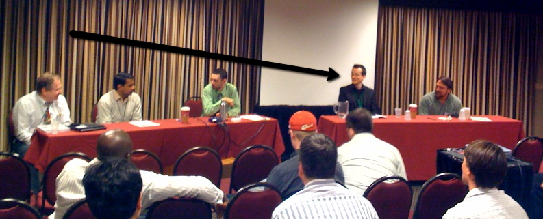
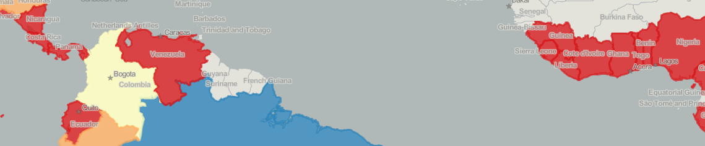

*GeoIQ and an Origin Tale*

In 2009 I was a "GIS Technician". Heaven help me, I was auto-completing polygons on good days and schema locking on bad ones, at a well-meaning but projection-free engineering firm with 300 AutoDesk licenses and 5 ArcEditor seats. It was the worst of times.
Early on that year I took a week off to go to Las Vegas with my wife, who was presenting at the [AAG conference](http://www.aag.org/cs/annualmeeting/videos/2009_las_vegas/overview) there (she's the brains of the outfit). Benefiting from the super-low "Spouse" attendance fee (academic geographers take note), I wandered from one cool session to another, my brain stimulated in new and exciting ways. I watched in a standing-room only crowd as Jack Dangermond explained how [mashups (remember those?) were going to solve Africa's problems](http://www.aag.org/cs/annualmeeting/videos/2009_las_vegas/geography_gis_and_africa_with_jack_dangermond), and I saw my first demonstrations of [Object-Oriented Image Analysis](http://letters-sal.blogspot.com/2009/10/meaningful-objects.html) and Hyperspectral wetlands detection. Cool enough, but there was something disheartening about the fact that 95% of the map crunching I saw was being done by ESRI products.
On a whim, I went to a panel session called "Open Source GIS". Probably for the damn novelty of it, but also maybe due to some lingering frustration from being license-bound while trying to do mapping work in my peace corps years. The little room was about 3/4 full and the panel consisted of some folks from USGS who used GRASS and PostGIS, and also an animated fellow named Andrew Turner from FortiusOne, who had a few things to say.

|  |
| --- |
|  |
| The Open Source GIS Panel at AAG 2009. Note the overdressed gentleman about to drop some science on us. (Photo courtesy of  Shriram  Ilavajhala) |

It was no great conversion moment. The session covered some pretty wonky stuff from the perspective of a button-clicking non-coder, though the enthusiasm was palpable in the audience. The real "Glitch in the Matrix" hit when I talked with Andrew after the session. In an information stream that challenged the human limits of spoken words per minute, he told me it might be helpful if I downloaded Quantum GIS ([1.3, yo](http://download.osgeo.org/qgis/win32/).) and took a look at [GeoCommons.com](http://geocommons.com/). Back at my computer, the world opened up to me; this was the starting event that would lead to the creation of [Geosprocket](http://www.geosprocket.com/) a year later, and for that I am eternally grateful.

|  |
| --- |
|  |
| An early, misguided attempt to use GeoCommons in mapping global coffee production. Things have [gotten better](http://vtgeol.geosprocket.com/). |

In that session and in subsequent interactions, Andrew conveyed two motivations for his work with FortiusOne-thence-GeoIQ.

1. *Open Source*: OS software is just the tip of the iceberg. It fosters a culture of innovation and robustly supports the tools that people want most.
2. *Open Data:*Geographic information should be a public good (Geo"Commons" - Get it?), and we can all benefit from driving maps into the public sphere.

These drivers were not unique to GeoIQ; they are dear to many in our community. Over time I have adopted these and included them in the core of Geosprocket's mission. As such it was something of a body blow this morning to read the news that [GeoIQ had been purchased by ESRI](http://blog.geoiq.com/2012/07/10/building-from-the-inside/). The pundits have [already weighed in](http://spatiallyadjusted.com/2012/07/10/esri-eliminates-geoiq/) eloquently [on this deal](http://blog.geomusings.com/2012/07/10/geoiq-esri/), and I can't add any new market analysis. I've even run out of snark. I can only mourn a bit to see GeoIQ forced to choose between open source and open data, for they have surely chosen the latter.
I have no doubt that ESRI's resources will supercharge GeoIQ's pursuit of open data. If Jack and co. have the wisdom to scrap ArcGIS Online and replace it with "ArcIQ" the world will be a better-informed place. But I'm going to miss the [code](https://github.com/geoiq/TileStache) [contributions](https://github.com/geoiq/acetate) of some talented individuals. I raise a glass to them for getting me started in this business.
