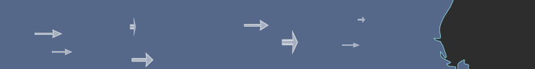
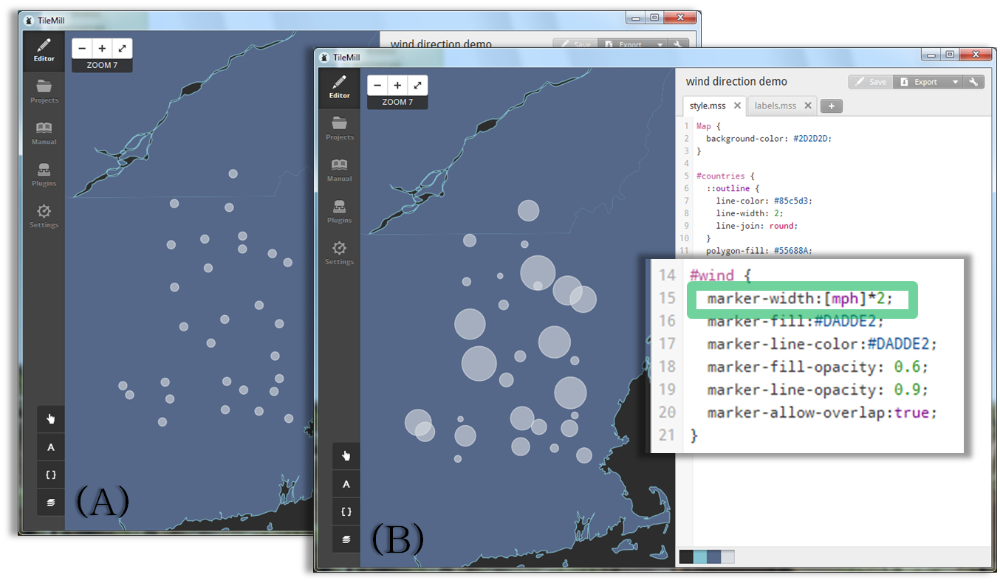
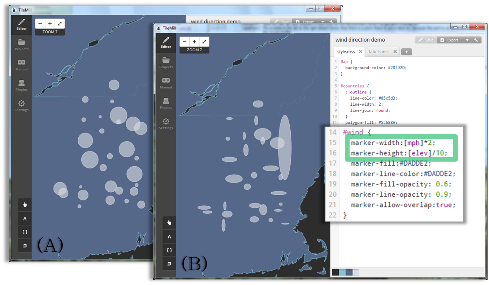
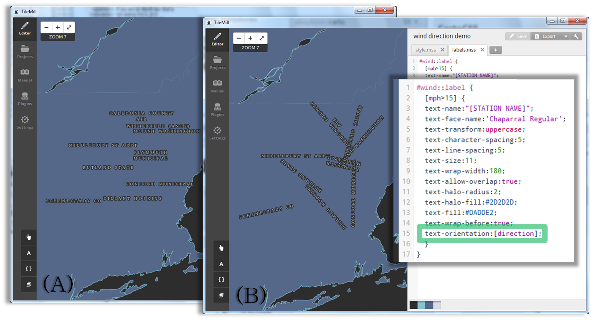
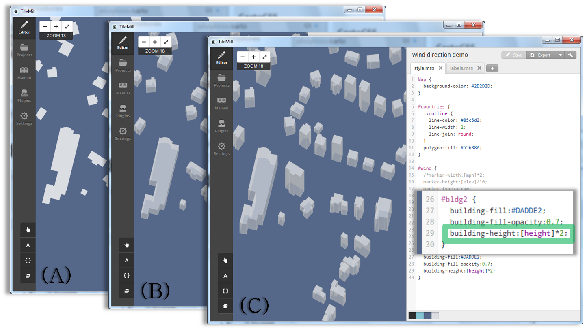

The term "disruption" makes me want to stick a hot poker in my eyes, and then post a tilt-shifted instagram pic of that poker laying on a table next to a lychee mojito.
However, "disruption" is an accurate description of the state of cartography over the past two years or so. The traditional realm of the GIS analyst has been invaded and turned upside-down by an army of new cartographers who come from a software development background. These visigoths have brought odd notions like [efficiency](http://mapbox.com/blog/modest-maps-and-leaflet-new-choices-web-apis/), [economy](http://mapbrief.com/2012/08/01/how-the-public-actually-uses-local-government-web-maps-metrics-from-denver/) and - heaven help us - *[design](http://maps.stamen.com/#toner/12/37.7706/-122.3782)* to the mapping field, but wow do they have a different process for making maps.
This dichotomy between GIS-er and carto-developer is visible in the [CartoCSS](http://mapbox.com/tilemill/docs/manual/carto/) language. Stemming from a project called [Cascadenik](https://github.com/mapnik/Cascadenik), CartoCSS is a collection of stylesheet code that allows a mapper to assign symbology to geodata and render it with [Mapnik](http://mapnik.org/) - by far the best image rendering engine available for cartography. This code distinctly resembles the assemblage of rule sets, blocks and properties that any web developer would use to style a web page (hint: the target user base):

```
 #wind {    
    marker-width:5;    
    marker-fill:#DADDE2;    
    marker-line-color:#fff;    
    marker-fill-opacity: 0.6;   
}
```

The highest-profile deployment of CartoCSS is in the excellent [Tilemill mapping platform](http://mapbox.com/tilemill/) from the folks at [Development Seed](http://developmentseed.org/). The code drives every style choice you make in Tilemill, then it compiles everything to Mapnik and delivers you exceptional graphics, both static and web-ready. This is great news for developers, who are already comfortable with code in their workflows. Not so much for the GIS analysts (like me) who have been Arc-trained for years on how to push buttons and move sliders in the quest for a good map. Also, CartoCSS has had limited functionality for thematic mapping - a common complaint is that you can't do multivariate symbology (graduated colors and symbols, say) without [awkwardly-nested code cascades](https://github.com/wboykinm/geosprocket-carto/blob/master/mtl_nightvision/style.mss#L327-387).
Until now, that is. A key development has been taking place behind the scenes, one style parameter at a time -- data-driven symbology has arrived in CartoCSS as of Tilemill version 0.10.0. Let's take a look at what this means:

|  |
| --- |
|  |
| Figure 1 - Marker Size |

Previously, you needed to specify a hard number as a value for almost every style parameter. Translated, that means the point data (representing weather stations) in figure 1A was coded like this:

```
 #wind { marker-width:10; }
```

To make graduated symbol sizes, you previously had to put in a plague of conditional statements over many lines, each pointing to a different value for marker width. Now you can just pull those numbers from attribute data; in figure 1B, the points are graduated based on average wind speed, with the values coming from the attribute field labeled "mph":

```
 #wind { marker-width:[mph]; }
```

You can even manipulate the attribute-derived values directly in CartoCSS with basic math. In figure 1B, I've multiplied everything by 2 for an exaggerated effect. Things get interesting when you try styling on multiple variables - one on symbol width (wind speed) and one on symbol height (station elevation) in figure 2B:

|  |
| --- |
| |
| Figure 2 - Multivariate Symbology |

Label placement has long been the lone data-driven feature in CartoCSS. This code renders the weather station labels in figure 3A:

```
 #wind { text-name:"[STATION NAME]"; }
```

Now you can orient labels directly from a column, for instance to make them point in the average wind direction in figure 3B below (fun but cartographically criminal). [Makers of typographic maps](http://store.axismaps.com/product/typographic-map-washington-dc) should pop a celebratory beer over this one; a little bit of geoprocessing and your work is automated now. [*Update:* I'm told the real purpose of this is to orient interesting text characters like Arrows (-->). It's all fair game.]

```
 #wind { text-orientation:[direction]; }
```

|  |
| --- |
|  |
| Figure 3 - Label Rotation |

Building heights for "Pseudo-3D" effects can also now be pulled from attribute data. Figure 4A shows building outlines, 4B shows all buildings rendered with a height of 8pts, and 4C shows them rendered at actual height in meters with a vertical exaggeration of 2. Woot.

|  |
| --- |
| |
| Figure 4 - Dynamic Building Heights |

The possibilities are not limitless here. It takes a fair amount of chopping away at the Mapnik source code to enable each of these data-driven parameters, so [the list of available ones](https://gist.github.com/3229978) is still pretty short. Nor does this make CartoCSS the absolutely-ideal entry platform for a GIS analyst looking to get into "Map Development". However, this represents a forward leap in ease of use for mappers of all stripes, and I look forward to seeing what the community can do with this functionality.
