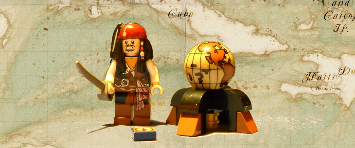

|  |
| --- |
|  |
| High Seas by [AJ Ashton](https://tiles.mapbox.com/aj/map/Sketchy2). Pirate by Lego, clearly. |

ESRI has made some interesting moves in the web mapping space in the past year. I don't blame them for being desperate to get a grappling hook up on a ship dominated by a combination of Google Maps and an open-source polyglot, but at this point the attitude is starting to border on dickish:

- Step 1: [ESRI rumbles](http://blogs.esri.com/esri/arcgis/2012/02/09/whats-new-in-arcgis-online-february-2012/) toward a unified way of getting licenseholders' data online, while pulling a group of [early innovators](http://blog.geoiq.com/2012/07/10/building-from-the-inside/) - GeoIQ - onboard to help. Admirable.
- Step 2: [ESRI adopts the term "Web Map"](http://blogs.esri.com/esri/esri-insider/2012/07/17/web-map-intelligent-map-story-map-what%E2%80%99s-the-difference/) along with "Story Map" and a few other items that they [clearly](http://mapstory.org/) [stole](http://mashable.com/2010/03/10/google-maps-biking/). No worries; a bit of rebranding and we're all one big-happy-web-mappy family, ESRI, Google, FOSS4G and your grandmother with her Bing API side project.
- Step 3: ESRI kicks everyone else off the boat they just boarded. [Now only ESRI makes "official" web maps](http://www.geo-jobe.com/blog/2012/08/29/the-official-web-map/), and clients should be wary of cut-rate imitators. Specifically a "Web Service" is only an ESRI REST service, and a "Web Map" is "[Like an] .mxd file, but for the web."

Okay, this is an oversimplification - particularly that step 3 doesn't come from ESRI directly, but from [a well-intentioned partner](http://www.geo-jobe.com/). Well-intentioned because the author clearly wants the "Average GIS professional" to have access to the brave new world of the cartointerwebs and that path is [not currently an easy one](http://geosprocket.blogspot.com/2012/05/browser-cartography-manifesto.html). But this attitude doesn't arrive in a vacuum; [ESRI has cultivated it](http://blogs.esri.com/esri/arcgis/2012/04/16/an-intelligent-map-checklist/) in the hope that no one will notice they didn't innovate the web mapping space. Web developers did and still do. Folks from tiny open-source shops all the way up to search giants.
Fair play to the big guy with the marketing budget, you say. But here's why I want the developers that built this ship to retain control of it: THEY'RE BETTER AT IT. The user experience is uniformly superior in non-ESRI web maps, the implementation costs are lower and the data is faster. Though this will change and ESRI will catch up if new hires like Sean Gorman [have anything to say about it](http://flic.kr/p/d2bQEs).
But for now I would love to see a bit of humility and willingness to listen on the part of the GIS giant, instead of taking the ship by storm and kicking off everyone who knows how to steer it.
