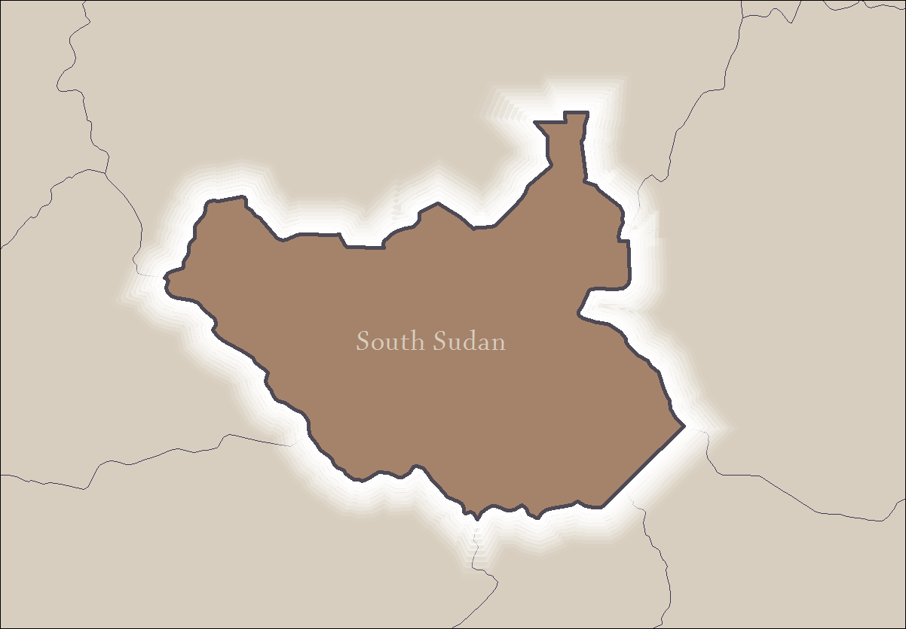
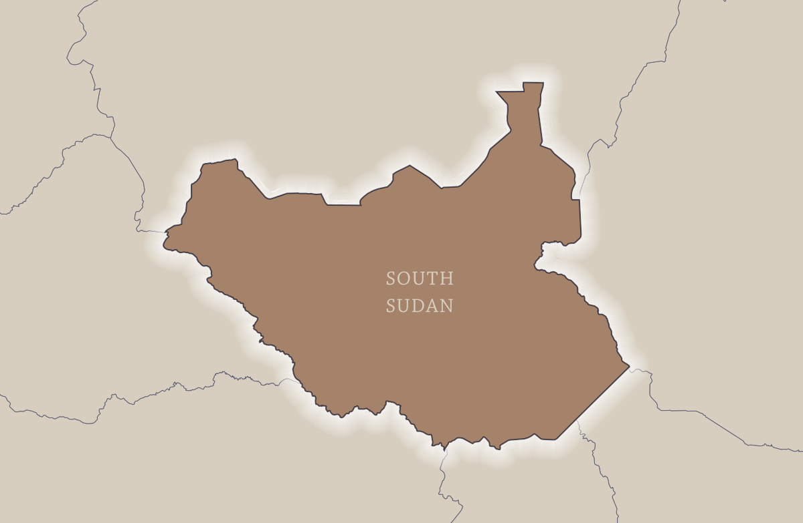
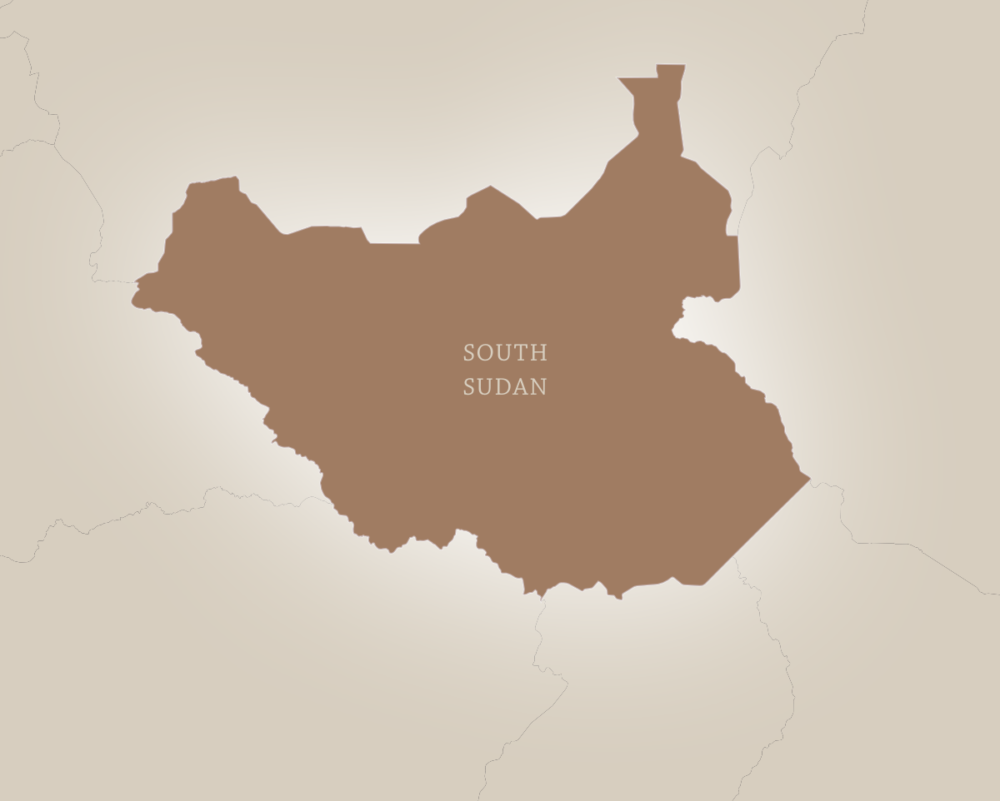
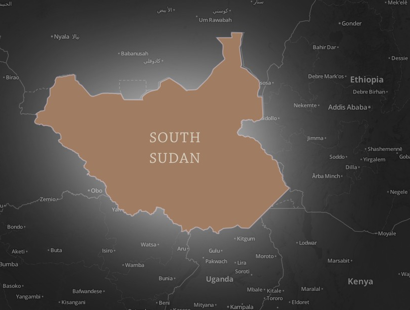

Since the ancient days - well, since late 1993 or so - production cartographers have been been stuck in an awkward technical limbo between GIS and art. [Two platforms](http://www.gsd.harvard.edu/gis/manual/illustrator/index.htm) were required to get a map from vector geoprocessing to publication-quality graphics: Mostly ESRI's ArcGIS for the former and mostly Adobe's Creative Suite for the latter. Sure the two tried to overlap each other as time went on ("Seven hours to export a 900dpi TIFF and I can still see the pixels? Thanks ArcMap!"), but the basic math was tough to overcome: with finite memory on a workstation, ArcGIS focuses its resources on geoprocessing at the expense of the graphic outputs, and vice-versa.
This was the way of it when I started mapping. And the classic example of "You can't do that in GIS" is the buffalo tint [popularized and used to wicked effect by National Geographic Maps](http://maps.nationalgeographic.com/maps/print-collection/sagarmatha-national-park-map.html). Basically it's a targeted feature fade, meant to draw attention to a focal point or to one side of a divide. And pretty hot too.
And it's not really possible in ArcMap. Here, let's try doing the inverse of a fade, which is easier to envision. This is more of a halo, and it's theoretically possible to do this by adding line layer after line layer, each offset and transparent-ed a bit more than the last:

|  |
| --- |
|  |
| Buffalo Halo a la ArcMap |

Not too shabby, I suppose. A fade out from a clear focal feature. Maybe a bit heavy-handed, but it gets the message across. Too bad it took 30 minutes of clicking into *five successive sub-menus on each of ten layers* to get it done. And since ArcMap isn't a graphic engine, there's no anti-aliasing, and pixels are visible in every feature. This is not a production-quality graphic.
Let's try that again with [Tilemill](http://mapbox.com/tilemill/). I know I know, it's not a GIS engine, but it's a lot closer to one than Adobe Illustrator is, [try as they might](http://layersmagazine.com/mapublisher-8-1.html). Tilemill has full support for operations like selecting and styling by attributes as well as basic geoprocessing if the data is tied to a source like PostGIS, Google's data API or CartoDB's SQL API. Also it's free and open-source (I love that such news is ancillary to my point here. Woot!). As [I've mentioned before](http://geosprocket.blogspot.com/2012/08/data-driven-symbology-in-carto_7.html), Tilemill brings the efficiency of CSS code to the map styling process, and it pushes everything through the sophisticated Mapnik graphic driver to look damn pretty for web or print.
Code will save us, right? Here, check it out:

|  |
| --- |
|  |
| Buffalo Halo a la Tilemill |

This is a more subtle effect, with no striping artifacts, and all the linework is anti-aliased for smoothness. Bonus points for also providing [an interactive output](http://a.tiles.mapbox.com/v3/landplanner.buffalo2.html#5.00/7.320/31.330) where the halo scales dynamically.
So what kind of [Carto CSS](http://mapbox.com/tilemill/docs/manual/carto/) went into that? Oh, just *[more than three hundred lines](https://gist.github.com/3668668) of recursively offset style code.* Oy. It's true that it's portable (feel free to plug the code into your own project), but it's not ideal. Definitely not for fast projects under a deadline.
This is where compositing comes in. Last month, the indefatigable Mapnik team added support for [the graphical magic](http://www.imagemagick.org/Usage/compose/) that underpins programs like illustrator. This is part [of a long-running effort](http://mapnik.org/news/2012/08/27/stamen-compositing-mapnik-v2.1/) by cartographic designers at [Stamen](http://stamen.com/) and [Development Seed](http://developmentseed.org/) to get out from under the Iron Adobe boot. (or the supple [GIMP](http://www.gimp.org/) moccasin, I suppose). With compositing, all sorts of things become a lot easier to do in Tilemill, for instance what we've been trying above is now [about 30 lines of CartoCSS](https://gist.github.com/3671174), and much richer:

|  |
| --- |
|  |
| Buffalo Halo with Mapnik Compositing Mojo in Tilemill |

The possibilities are sort of mind-boggling, and I invite all the actual graphic designers of the world to figure them out (The composite parameter alone in CartoCSS has 35 options). In the meantime I'll continue to look for ways to enhance my mapping toolkit; [the next post](http://geosprocket.blogspot.com/2012/09/the-buffalo-in-room-part-2-fade-out.html) will focus on reversing the direction of this effect, like in the NatGeo example linked above.

|  |
| --- |
|  |
| Free-Range Buffalo Halo, Thriving in its Natural Environment. |

*Thanks to [Dane Springmeyer](https://twitter.com/springmeyer) for pointing out the time-saving parameters on this one.*
