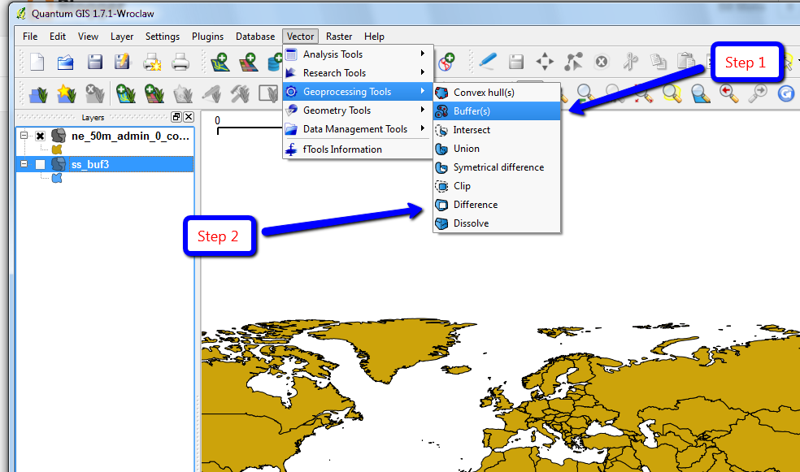
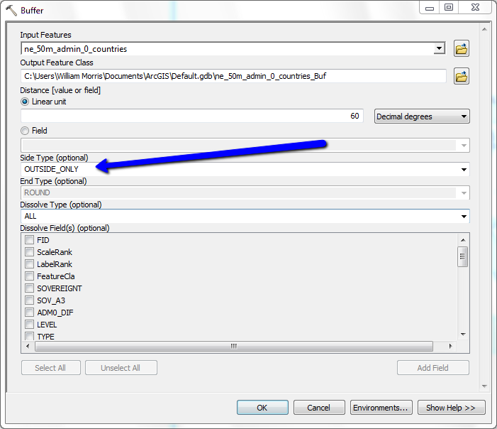
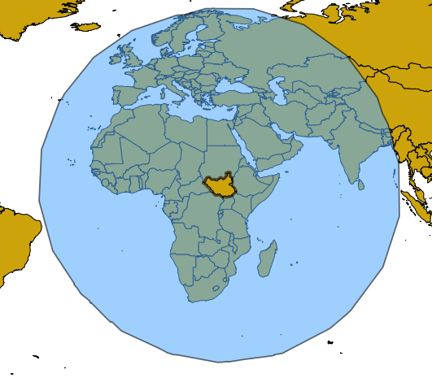
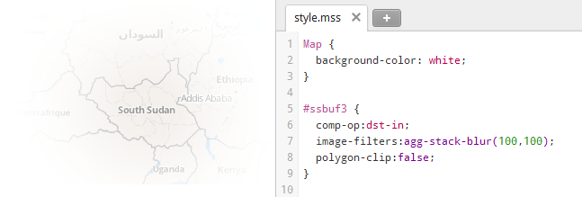
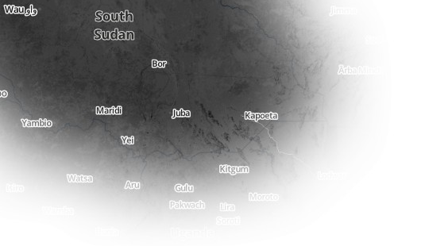

[In the last post](https://billmorris.io/shoals/gis/cartography/2012/09/12/the-buffalo-in-the-room-part-1-fade-in.html) we looked at the many difficult paths that can take us to the summit of cartographic nirvana known as the "Buffalo Tint", [as rocked by National Geographic Maps and others](http://maps.nationalgeographic.com/maps/print-collection/colorado-basin1-map.html)
As I noted, this effect has traditionally been impossible to pull off in a GIS platform like ArcMap or QGIS. [Tilemill](http://mapbox.com/tilemill/) initially got us a little bit closer by giving us full control over styling possibilities with [CartoCSS code](http://mapbox.com/tilemill/docs/manual/carto/).
But now, as of Tilemill 0.10.0, compositing functions make this kind of effect a snap. Let's look at making a full Buffalo Fade, still using South Sudan as an example. Specifically, we're going to make a fade mask in Tilemill that can be laid over some [Mapbox base layers](http://mapbox.com/tour/design/) in a web map.

---

### Step 1: Preprocessing a Mask

This step - preprocessing in a GIS platform - is optional, it just depends on where you want the fade to begin. The purpose of preprocessing is to create a fixed feature mask;

- QGIS: Run a buffer on your focal feature, larger than the convex hull of the feature for good measure. [Then run a difference process](http://flic.kr/p/d9w8SC) between the buffer and the focal feature.

- ArcGIS: Run a buffer on the focal feature, [with "Side Type" set to OUTSIDE-ONLY](http://flic.kr/p/d9w1jA), again to a good distance out beyond your feature's bounding box.

Either way you're aiming for a feature mask that looks like this:

---

### Step 2: Into Tilemill

Then import that feature mask into Tilemill and style it with what might be [the most efficient piece of code](https://gist.github.com/3692831) I've ever cobbled together, compositing the feature mask to fade inward from its border:

*[Alternately, in this case you can do it by just compositing every country that isn't South Sudan and eliminate the buffer processing above. [Here's the CartoCSS](https://gist.github.com/3691077) to do that]*
That's it. Export to MBTiles format and drop it on top of a base map of your choice. You're off to the races:

There are still a few bugs when using this [for dynamic tiles](http://dev.geosprocket.com/swipe-buffalo.html), notably some tile-edge artifacts that break up the smoothness. But overall I'm looking forward to messing around with these new compositing capabilities
