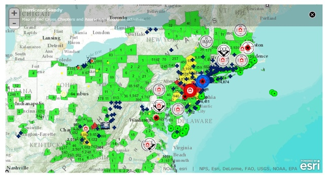

I was scoffing at Twitter a few years ago. Actually, I was openly mocking it, jeering that [perhaps 140 characters was too verbose](http://www.youtube.com/watch?v=BeLZCy-_m3s) for the new world order.
Then came Hurricane Irene.
Vermont got slammed to a degree we hadn't experienced in a century. Flooding cut off whole towns and wrecked hundreds of miles of roads. Communications were a thicket of half information and delays as the news media tried to step in for a crippled emergency management system. But while working with [the Ushahidi platform](http://ushahidi.com/) in support of [VTResponse](http://vtresponse.com/), I discovered that Twitter was ablaze with actionable info. 14,000 tweets used the #vtirene or #vtresponse hashtags during the storm, and [Ushahidi vacuumed them all in](https://vtirene.crowdmap.com/) for automated and manual analysis, then channeled them off to state and local officials. I saw the power of Twitter.
These capabilities were recently tested again when Hurricane Sandy showed up, and with a bit more experience I observed that Twitter by no means removes all the noise and confusion. Two incidents raised my hackles:

- Burlington, VT - and indeed the broader Vermont community - have long used the #BTV hashtag to organize news that runs from mundane to crisis-critical. I had configured a new instance of Ushahidi to note #BTV tweets as Sandy got closer, so it caught me off-guard when Bloomberg TV started soliciting photos of storm damage using #BTV. With visions of flood-isolated Vermonters unable to get their message through a deluge of Manhattanite instagrams, I politely asked that they use a different channel. I heard nothing back from the TV station, but it was a moot point; they got very little traffic on #BTV despite the fact that NYC got walloped and VT mostly escaped unharmed.

- Encouraged by the successful use of Ushahidi and [Google's Stratomap](http://code.google.com/p/stratomap/source/browse/templates/base.html) plaforms for crisis mapping during Irene, the world's largest producer of mapping software - [ESRI](http://www.esri.com/) - decided to go full-court press during Sandy with their own crisis response web maps. The problem is they're not that good at it. Taking more of a marketing approach, ESRI blanketed Twitter and the #sandy hashtag with links to "Map galleries" full of redundant chartjunk, mostly pulling data from FEMA and local response agencies.

|  |
| --- |
|  |
| "How do I get to a Red Cross station? Yellow dots, blue crosses? I have to install Silverlight to view this?" |

On Twitter, this diverted thousands of clicks worth of traffic away from information Rally points like [Google](http://google.org/crisismap/sandy-2012) and FEMA (who was actually [using ESRI web tools](http://fema.maps.arcgis.com/home/), just with some forethought). Ironically, almost every emergency response agency was using ESRI's desktop software to coordinate infrastructure and personnel; ground-level geocrunching is ESRI's great strength. But their half-baked web tools only served to dilute any sense of authoritative information on Twitter as Sandy raged into the coast. Afterward I had a productive conversation with ESRI's Public Safety Marketer, but it's not clear that their approach will change in the future. Hopefully their tools will.

These complaints each deserve a post of their own, but I prefer to minimize my ranting about the negative side of technology. However, I'll be bearing all of this them in mind when the next emergency hits and we look to Twitter for rapid distribution of news. For better or worse, Twitter and Facebook are tools of public information during crisis situations, and it is incumbent on us to amplify the signals of highest priority and applicability.
