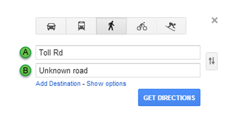
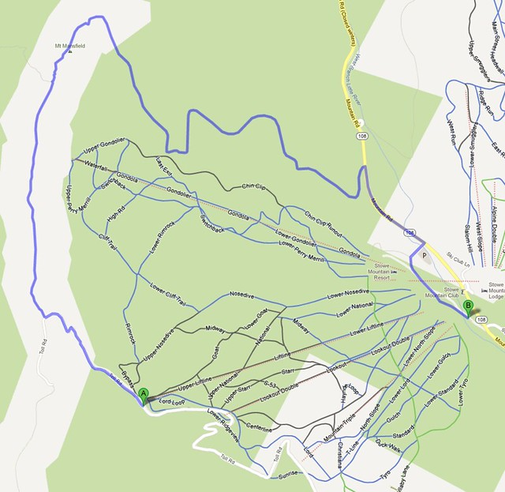
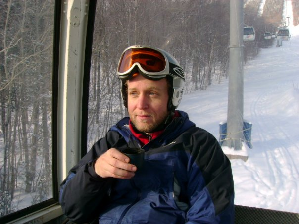

|  |
| --- |
|  |
| We're not there yet . . . (Skier dude by Saman Bemel Benrud) |

The news yesterday was that [Google has added the trails of 38 ski resorts](http://google-latlong.blogspot.com/2013/02/ski-resorts-now-on-google-maps.html) in the US and Canada to its Maps database. Here in Vermont, my stashes are safe from further encroachment, since the only two Green Mountain resorts on the list are perennial tourist-bait favorites [Okemo](https://maps.google.com/maps?ll=43.405702,-72.729278&spn=0.021357,0.052314&t=m&z=15) and [Stowe](https://maps.google.com/maps?ll=44.530902,-72.789316&spn=0.020956,0.052314&t=m&z=15). That said, this is a cool move by Google in its desire to permeate our mobile world. I'm used to leaving my phone behind while I ski, but this sort of information would be useful to have at my fingertips if I were in unfamiliar terrain at a new resort. It could also be useful in tandem with the ski-run-tracking apps that are proliferating these days.
However, one item is missing from the new functionality: ski navigation. You can't request the shortest (or gnarliest) route from the top of the Sensation Quad to the bottom of the Alpine Double. These new lines - while color-coded according to difficulty - are just background images in Google's otherwise-rich network of information. The navigation engine suggests that the shortest route down the Liftline at Stowe is to pop off my cables and trudge down the Toll Road or the Long Trail.

|  |
| --- |
|  |
| The longest way around |

I can see why Google would be nervous about offering directions in this context - There are two problems that are unique to alpine skiing as a navigation paradigm:

### Obey the Rope.

Trail conditions (especially in the East) change more rapidly than road conditions. However, they don't change more rapidly than traffic conditions, and Google's got that covered in near-realtime in major metro areas.

> **Solution: GTFS for ski resorts** - While it's not immediately realistic to ask every resort to come up with a trails API, it's possible to work out a common format for [trail reports](http://www.boltonvalley.com/the-mountain/snow-report-and-maps) (Y'know, those things you look at in the morning to see where it's not bulletproof) much like [Google does for public transit](https://developers.google.com/transit/gtfs/reference). It would be an afternoon task for a data ninja at Mountain View to figure out a way of scraping and parsing that information on a daily basis.

### Gravity's a . . . Precondition.

Leaving nordic and backcountry skiing aside, ski navigation would require consideration of elevation change. No uphill turns allowed.

> **Solution: Spatial Analysis -**  This is one of those bread-and-butter geoprocessing problems that GIS undergrads are given: calculate a flow accumulation surface, add turn attributes to the trail data accordingly. This is actually kind of a fun one.

Lots of folks are never going to look at a mobile device while skiing, maybe myself included. But for the ones who do, it'd be pretty danged cool to have navigation assistance built into the vertical territory that Google is now adding to its already-thorough map system. Just a few hitches to overcome, and I think they're up to it :)

|  |
| --- |
|  |
| "If only there were some way I could technify this experience . . ." |
