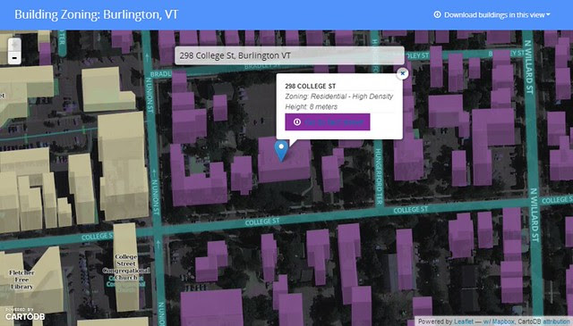
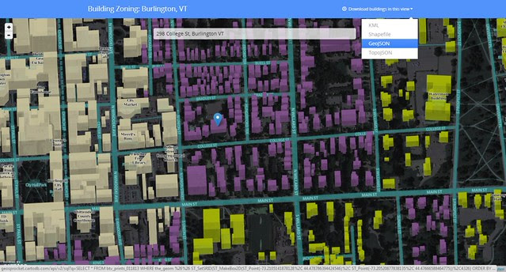
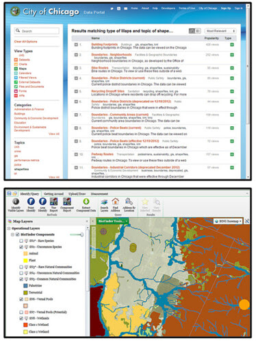

### A Geoportal Identity Crisis

A city wants to [open its geodata](https://data.cityofchicago.org/Buildings/Building-Footprints-Deprecated-December-2013-/6mpq-sfwi) for public use. An NGO wants to [spark a transparency initiative](https://data.worldbank.org/indicator/IQ.CPA.TRAN.XQ?view=map). A regional planning commission [wants to stop emailing zipped shapefiles](https://www.morpc.org/info_center/dataport/gis_downloadble.asp) when pestered. They want to deliver two contrasting products - raw data and parsed themes - to as many as a dozen different audiences: policymakers, technical service providers, the press, professional curmudgeons, etc.

In the past decade, the solution to this nearly-impossible balancing act has been to build a [Geoportal](https://en.wikipedia.org/wiki/Geoportal), and we've seen some pretty memorable misfires.

Most of the trouble can be chalked up to the good intentions of the technicians who produce the data and the tools to distribute it; accustomed to a desktop GIS environment for exploration and analysis, they have built and re-built "GIS on the Web" ([Chris Herwig](https://twitter.com/hrwgc) documented [his travels](https://web.archive.org/web/20130705152055/http://mapbox.com/blog/trouble-with-geoportals/) around a broad selection of them). They've done this under the assumption that users will be filtering, buffering, selecting by location and overlaying, and as it happens that's not really true.

This approach fails all sectors of the public.

For many months now, [Brian Timoney](https://twitter.com/briantimoney) has been championing sanity in the wasteland of geoportals. He expertly trolls the mapjunk and the faustian UX, but he's also offered an analytics-based selection of "Best practices" for getting geodata to the public. Beyond [how users actually interact](https://mapbrief.com/2012/08/01/how-the-public-actually-uses-local-government-web-maps-metrics-from-denver/) with online maps, he's [drawn attention](https://mapbrief.com/2013/03/26/the-flawed-economics-of-closed-government-data/) to the subtle distinction between "open data" and "useable open data".

But he is still something of a voice in the wilderness, as we all nod vigorously in agreement and go back to downloading file geodatabases from the USGS. We work with the system we have, because it's hard to envision the details of the alternative.

### A Template

I've been trying to envision such an alternative, spurred on by some adventurous clients. Specifically, I wanted to see if it was possible to crack open a public dataset in a way that was compelling to technicians as well as to the lay public - something that would adhere to [emerging best practices](https://mapbrief.com/2013/03/12/a-minimally-viable-property-lookup-service/) as well as to my own bias toward open architecture for open data. Timoney himself has already [taken a stab](https://mapbrief.com/2013/03/12/a-minimally-viable-property-lookup-service/) at this, but we have different styles.

So I cobbled together a template geoportal, wrapped around a standard multipurpose bit of public data: building records.

[Give it a spin here](https://wboykinm.github.io/modular-geoportal/).

I assumed two audiences: 1.) citizens who want their own zoning information and permit history fast, and 2.) analysts who want to grab bulk chunks of building footprint geodata for urban planning, disaster response or just noodling cartography. The former group can search for their address, see their building in context, and get the basic info before heading off to print their fact sheet. One minute or less.

The GIS specialists of the world can hit the download link and vacuum in all the features within the current view extent, in the interoperable format flavor that suits them (+TopoJSON for the bleeding-edge types).

This is just a page for a single dataset, but I think it meets the needs of both audiences and doesn't suck to look at or navigate. A few of the other features I wanted to include:

- Lightweight and Javascript-based - less than 1MB before the tiles show up.
- Shareable URLS - the root URL is subject specific, and the location hash allows users to pass around a [focused view of a neighborhood or house](https://wboykinm.github.io/modular-geoportal/).
- Traditional search (in the hanging dialog box) is prominent without obscuring the map, since I'm of the opinion that a map is better [as a page canvas](https://dev.geosprocket.com/lights/) than as a tiny sidebar window.
- Very few visible bells and whistles - This is built to some narrow workflows with no mission creep and no toolbars. A bunch of info is socked away in a modal popup for the intrepid.
- Cartography - I'm done with auto-pixelated graphics and [bad default symbology](https://www.flickr.com/photos/vtcraghead/8146933010/); this is 2013 and we should all be using Mapnik for the web.
- Open-source undercarriage - this is a combo of [Bootstrap](https://twitter.github.io/bootstrap/), [Leaflet](https://leafletjs.com/), [CartoDB](https://developers.cartodb.com/documentation/apis-overview.html) and [Mapbox](https://mapbox.com/developers/api/).
- A note on CartoDB and Mapbox - their server code is legit open-source (meaning I could just run it my own damn self), but I've used their hosted services here since it's just - ack - easier to let them handle the services and flexibility thereof. And still cheaper than the competition.

It's true that much of my requirements were about what to omit, but it is truly a difficult task to limit the scope of an application that is being driven to omni-functionality by stakeholders. Resistance is part of the process.

[Here's the code on github](https://github.com/wboykinm/modular-geoportal). The index.html is commented liberally, so you should be able to tell where to swap things in and out. Scaling this approach to an entire suite of geodata could be as easy as forking the repo for every dataset you want to present to the public. [Single-theme maps will see the most use](https://mapbrief.com/2013/03/15/your-online-map-is-missing-half-its-audience-more-revealing-web-analytics-from-the-field/) in the long run, so keep it simple.

### The To-Do List

This app needs typeahead in the search box to really deliver options. [Andrew Hill](https://twitter.com/andrewxhill) at Vizzuality [shows how easy this is](https://bl.ocks.org/andrewxhill/5171504) when pulling from a CartoDB address column, but I'm still trying to bolt it onto the partially-abstracted leaflet geosearch module with my meager javascript skills. I will gleefully accept pull requests. Additionally, you may note that each building's "Fact Sheet" points to the same place.

The city of Burlington is doing great things with its data, but we don't have building URLs keyed to parcel IDs or addresses yet :)

The bigger question is one of data discovery; if we're going to limit geoportals to one theme at a time, how do users get where they want to go? I hate being directed to a [silverlight-slinging "Map Gallery"](https://www.flickr.com/photos/vtcraghead/8598661996/) when I'm looking for info, but I'm not sure what the alternative is for top-level geodata search. Is it Chicago's spare text-based search? Is it the 300-button web GIS that requires training to use? Is it good SEO?

We know something about how users behave once they find the map they want, but how do we get them there in the first place?

*Listocracy from Chicago, GIS-in-a-browser from VT Nat. Resources*

Many thanks to Jay Appleton from the city of Burlington for being the single-handed support structure of open data here, including emailing the occasional zipped shapefile :)
