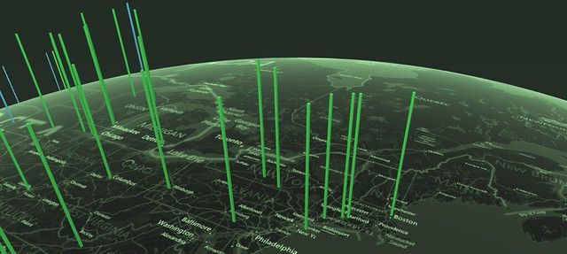
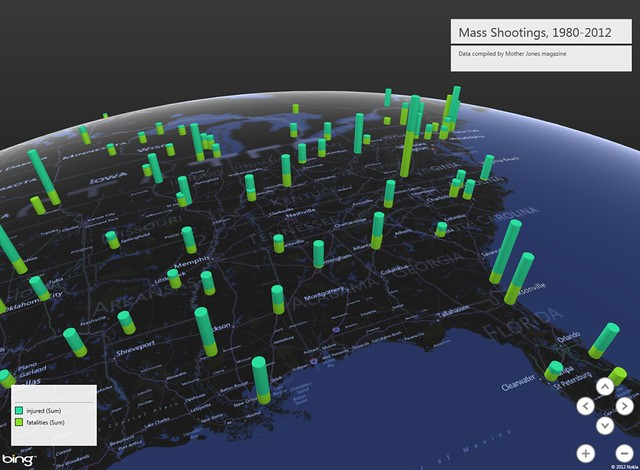
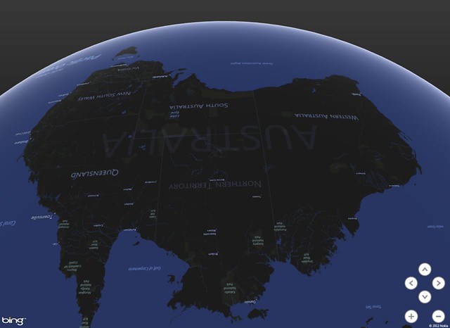

Remember those Microsoft guys?
Yeah, me neither. They're not really geo-involved in any loud way. Their contribution to GIS has consisted of a few excel plugins and a dedicated deference to the ArcGIS platform. They made a halfhearted attempt to enter the web mapping space with Bing maps, but it's safe to say the developer community hasn't expressed much interest:
> Despite my last Win8 Metro map project working flawlessly using @[leafletjs](https://twitter.com/leafletjs), I decided to give @[bingmaps](https://twitter.com/bingmaps) SDK a try. Don't do that mistake.
> — Marcel Šulek (@veproza) [April 19, 2013](https://twitter.com/veproza/status/325200490260484096)

But there are some geo-progressive (How many times am I allowed to use it as a prefix?) corners of the Windows empire, notable in the hiring of OpenStreetmap founder [Steve Coast](https://twitter.com/SteveC), and in a generous licensing of high-resolution imagery for OSM mappers. Add to that a new tool for Excel called Geoflow, which [launched to some fanfare Last week](http://thenextweb.com/microsoft/2013/04/11/microsoft-launches-geoflow-for-excel-a-tool-for-visualizing-3d-time-stamped-data-built-on-bing-maps/) as we all looked up from our maps with a collective "Microsoft? Really?"
I've been fiddling with it a bit since and I'm glad to have given it a try. It can probably be best described as the CartoDB/Fusion Tables of the desktop, and while that may sound like a backhanded insult, I think it will be extremely useful to the large and dedicated population of Excel users. This is not GIS. This is geovisualization, and it's not half bad.

The premise is simple - put your spreadsheet records on a map - and it executes with little difficulty. The user just needs a column with placenames (or coordinates), and the rest of the columns become thematic options in a 3D map without having to leave excel. The defaults are novel and in some cases visually appealing - which is fortunate because there's not a lot of tweaking you can do (Until Microsoft exposes a Visual Basic UI. Heaven help us.). The orthographic perspective is nice and the application did a better job of figuring out my data structure than excel usually does.
A quick roundup:

- Only available on Office 2013 for now.
- It's the antithesis of open-source but they get a temporary pass because excel is ubiquitous. I look forward to the LibreOffice Calc plugin.
- The Nokia-based geocoding is solid, with only one misfire to null island.
- The map UI isn't intuitive, but I'm not exactly sure if there is such a thing as intuitive 3D navigation. Maybe this is one for the [Leap Motion](https://www.leapmotion.com/) developers.
- Not portable. Unless there's some feature in the Office365 version that I'm missing, this is Geoflow's biggest shortcoming. The one nod to the desire to show your map somewhere other than in your cubicle is the "Copy Screen" button. Which I already had on my keyboard.
- The tour function is clunky, roped to a jerky graphics engine that [tries to load *every zoom level of tiles*](https://vine.co/v/bU6LmTihr3a)even after you've arrived at your stop. This happens every time, suggesting there's no tile caching at all.
- There's a nice selection of default map themes from Bing Maps, but they have trouble in the orthographic environment. Labels and imagery are slow to load, and text keeps its north orientation even if you want the Hobo-Dyer projection.

Overall: not bad, Microsoft. I like novelty, and they've somehow managed to combine some of the better elements of Google Earth with a spreadsheet and make it look compelling. I wouldn't say it's buggy, just in need of some UX rethinking. Ultimately it's good for all of us when a new map technology emerges from unexpected quarters.
