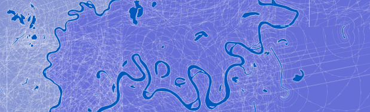
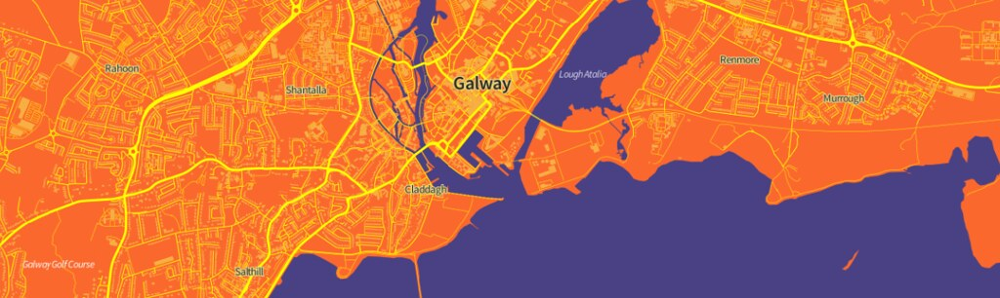
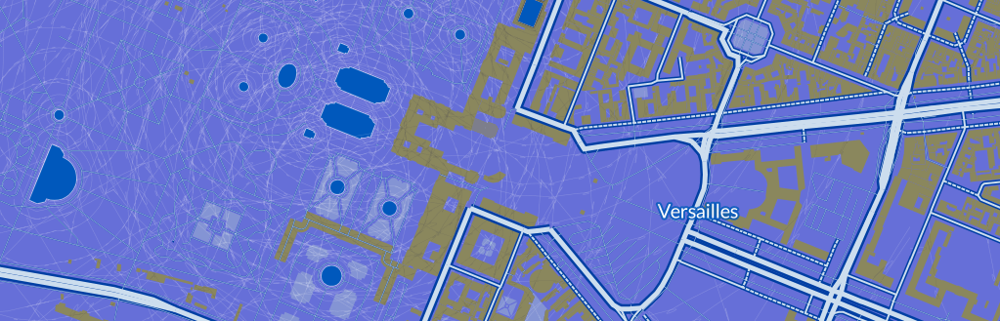
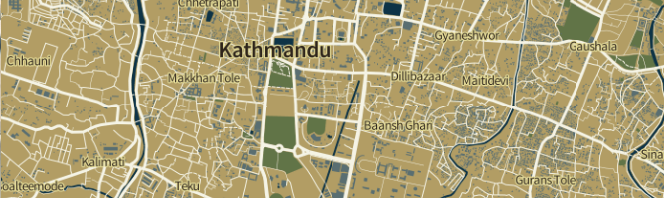
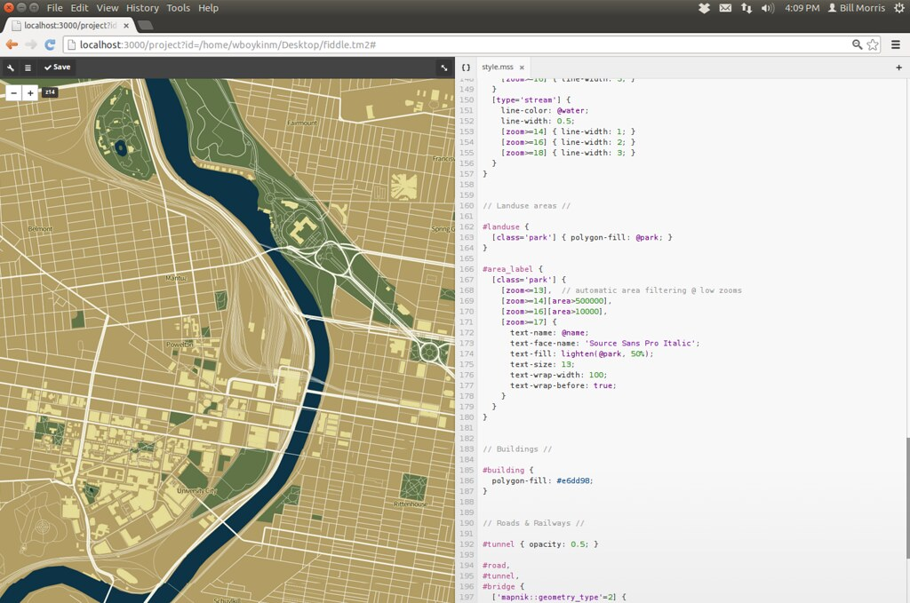

When I took my first GIS class, I was told that 5% of my time would be spent making maps, while 90% of it would be spent corralling data into usable format and 5% would be spent beating an unresponsive plotter with a cardboard tube. This balance has definitely changed as interoperability has gone from prayer to practice, but I've continued to be frustrated by the time I feel gets lost to a missing shapefile extension or a falsely-defined projection.
For all the fun afforded us by Mapbox's original [Tilemill map design platform](http://www.mapbox.com/tilemill/), it's always been sort of a GIS-y hassle to wrangle data into it. Mind you this is slight, glancing criticism - it's NOTHING compared to getting your geodata to work in Illustrator or any actual GIS platform. But I always found myself wishing I could spend less time racking my brain for where I put that awesome building footprint layer, or trying in vain to find the right ORDER BY syntax for a PostGIS datasource.
Perhaps you've heard, but [Mapbox sort of solved](http://www.mapbox.com/blog/vector-tiles/) my whiny problems. Tilemill 2 is in [unsupported alpha](https://github.com/mapbox/tm2), but it's already fulfilling my dream of data-agnostic cartography. The basic idea is that the world - as derived from [OpenStreetmap](http://www.openstreetmap.org/) - is some pretty centralizable basedata, so why not just tap the source and style it however you like? Instead of pulling extracts or copies or subsets, Tilemill 2 just gives you the whole damn world, all [330GB-and-counting](http://wiki.openstreetmap.org/wiki/Planet.osm) of it, via super-fast vector tiles (great explanation [here](https://github.com/mapbox/tm2/blob/master/README.md)). You get to style those tiles with the CartoCSS language, and at that point they're ready for your audience.
It is A LOT of fun to have the world at your fingertips:

For the moment there's no export or serving option, and it'll be interesting to see what Mapbox does with this tool in its already-robust custom mapping lineup. It's also worth noting that planet.osm is not ALL TEH DATAZ - we'll always need a way to use local or personal geodata. But this is a great leap for an already-impressive platform.
It's liberating to be able to focus on cartography with the building blocks already in place.

*Props to Gretchen Peterson for [some great color ideas](http://www.gretchenpeterson.com/cartographers-toolkit.php) as I fiddle with this.*
