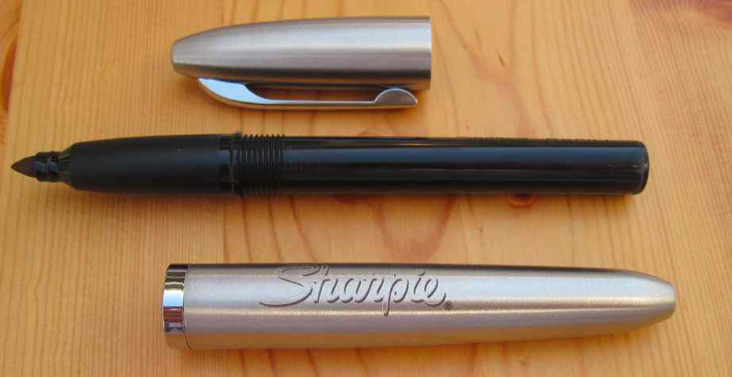

I was just having a conversation with some colleagues about the nuts and bolts of participatory mapping with some local farmers. We were all:

> "Man, it totally depends on if you have internet at the site. If you do, just pull up Google Maps or CartoDB and have them digitize right into the iPad. If not it's a huge hassle; you'd have to annotate a PDF and georeference it later."

> "Yeah, but either way the stylus is key. Non-technicians always want to use a pen and paper."

This talk of getting a skeumorphic data-entry device in the hands of the common folk reminded me of something from the past. This, specifically:

> Even taking as a fact of life that community GIS will always require some mediation by the more technically skilled, Al-Kodmany's Chicago neighbourhood projects are not a little bit extreme. In fact, by the time he describes the community members being given 'coloring the map' participation exercises as a way to actually participate, there is a rather patronizing air about the project. 'Participants were broken into small groups and were given a map and felt-tipped markers,' he writes. Felt so as not to inadvertently poke out their own eyeballs, no doubt.

This from Christopher Miller, [writing in 2006](https://courseware.e-education.psu.edu/downloads/geog884/miller_2006.pdf) about how participatory GIS (nee "GIS/2") was being hamstrung by academic condescension, cultural barriers and the failure of imagination that is traditional GIS ("GIS/1"). Man, 2006 sounds like a long time ago from here, but we're still spinning our wheels in some ways on this stuff.

---

Based on Andy Woodruff's Boston-oriented project, last year I built an app to get locals [defining the boundaries of neighborhoods](https://gist.github.com/wboykinm/dfe44481d8ff759c4f1afea223a7c070) in the city of Burlington. When I showed up to the first hearings on city redistricting to present the results, their credibility was questioned by some who hadn't heard of the project, even though it had been announced in every local news outlet as well as digital channels. These were people who showed up to meetings, because *that* was how you participated. Not learning my lesson, I [adapted Azavea's Districtbuilder app](http://btvvotes.org/) for the redistricting process and made it public, hoping "participatory technology" would open a traditionally-closed political world. It turns out that [the technology wasn't really the problem](http://www.7dvt.com/2013back-drawing-board-why-burlingtons-redistricting-process-breaking-down).

---

In his snark-laden, brilliant 2006 paper, Miller goes on to describe this neat little app called Scipionus, built in the aftermath of Hurricane Katrina on the back of a newly-opened Google Maps API. Here's the thing: *it let anyone with a web connection [report their location and status](http://ircworld.blogspot.com/uploaded_images/scipionus-700252.jpg) on a Google Map!* Fast-forward three years and Ushahidi comes along. Fast-forward another three years and Google Maps gets collaborative, Crowdmap is everywhere and Twitter becomes a news source. Fast-forward to last month and [the most reliable information on a civil war](http://irevolution.net/2012/03/25/crisis-mapping-syria/) is from a participatory map, and Ushahidi can take in reports from every technology short of smoke signals.

We still don't have good retorts to Miller's challenges. We still haven't made GIS accessible to the public, and I'm not really sure that's a valid goal. More importantly, we seem to be driving deeper into the gulch between Internet-Worshippers and Tech-Hostile Curmudgeons that Miller warned us about. Whether we're community-building, solving disputes or reporting the news, we've got to do a better job building bridges between the public and our maps.

In many cases, "Paticipation" is still a felt-tipped marker jabbed into the eyeball.
