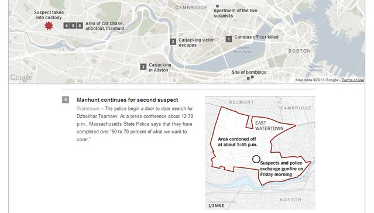
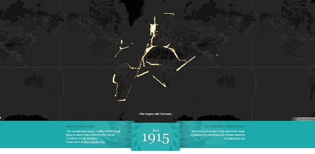
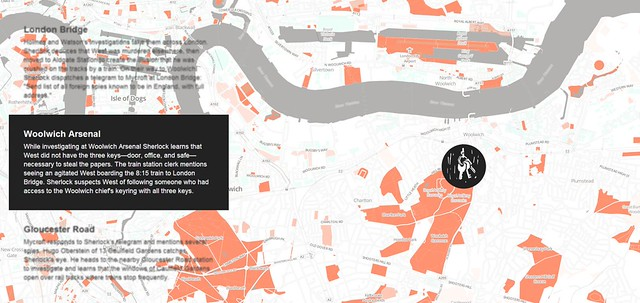
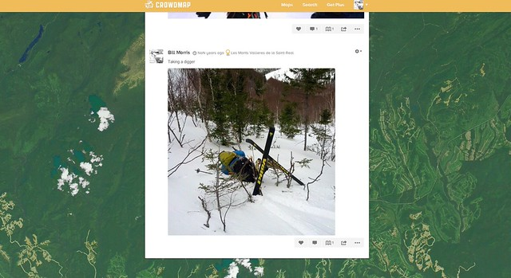
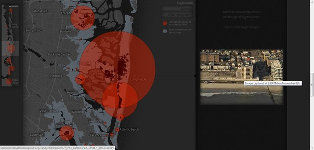

Some recent [thoughts by Brandon Rosage](http://cognition.happycog.com/article/maps-should-be-crafted-not-plugged-in) reminded me that webcartographics (I should trademark that one) are the midst of a change. Since the dawn of [Mapserver](http://mapserver.org/), we've been building maps into our websites in a segregated fashion, often treating the map as little more than an <iframe> keyed to a CMS. This works well enough in a short blog or location description, but there are more engaging stories to tell with cartography, and better ways to deal with UX complexity than just adding more markers.

Fortunately some great developers are steadily building tighter integration between geography and web design. My favorite recent examples of this follow:

### 1. Chasing the Boston Bombers

A maps-in-the-background [piece on the Boston bombings](http://www.nytimes.com/interactive/2013/04/19/us/boston-marathon-manhunt.html) from the New York Times [Graphics Department](https://twitter.com/nytgraphics) uses a Google static map as a location-based table of contents to a scrollable storyline highlighted with more maps and photos.

### 2. The Royal Navy in WWI

From [Vizzuality](http://vizzuality.com/), a [moving record of Allied ship traffic in WWI](http://cartodb.github.io/oldweather_wwi/) was derived from their work crowdsourcing the transcription of old ships logs. This is more of a show than an interactive piece, which works perfectly to illustrate the flurry of activity around major geopolitical events.

### 3. The Adventure of the Bruce-Partington Plans

[Young Hahn](https://twitter.com/younghahn)'s Mapbox-based [adaptation of a Sherlock Holmes storyline](http://mapbox.github.io/tutorial-sherlock/) changes the click-and-drag paradigm of the web map by tying map navigation exlusively to a scrolling text storyline. Unlike the NYTimes piece above, the map does move - but only as the narrative progresses. Bonus points that it's responsive, making this an equally-rich read on mobile.

### 4. Crowdmap's New Layout

[Crowdmap](https://crowdmap.com/map/chicchocs/) has some great potential here, though it's still being pulled in several directions by varying stakeholders. The previous version was [a codeless window into Ushahidi's functionality](https://vtirene.crowdmap.com/), and that was great for easy access to a map-within-a-CMS. But with the current iteration they've tried to bring the focus to a map driven by its content, rather than content accessed via a map.

### 5. Hurricane Sandy Coastal Impacts

Another entry in the the journalism category, [this tour-de-force](http://spatialinformationdesignlab.org/sandy/ny_coast.html) from [Derek Watkins](https://twitter.com/dwtkns) treats the coastal axis (North-to-South) as a narrative, attaching aerial photos seamlessly to a thematic map built with the [D3 javascript library](http://d3js.org/). Perhaps the coolest part of this one is what it implies - D3 is one of the best emerging tools for breaking maps out of "Plugin" status and letting them interact seamlessly with the architecture of web design. This is looking more and more like a window into the future of maps on the web.

