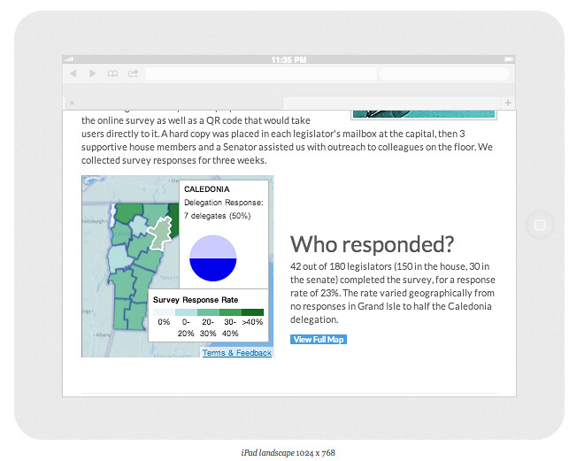
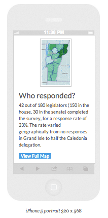

Heaven help me - I've been building a responsive infographic.
Specifically, I used [Bootstrap](http://twitter.github.io/bootstrap/scaffolding.html#responsive) to flesh out [a not-really-infinite-scroll site](http://wboykinm.github.io/vtpolitech) that summarizes the findings of a survey - done by some #opengov types on social media use in the Vermont legislature. Getting the infographic confession aside, my point in mentioning it is that I wanted to include a map of responses by county, and that posed a dilemma.
I went with a responsive layout for the page because I know that 50% or more of the traffic will be from mobile clicks - the kind of viewing experience that makes a tricked-out slippy map either frustrating or useless. So I'd need something more flexible than my usual portfolio. Fortunately, a few months ago responsive-design-zealot [Brad Frost](https://twitter.com/brad_frost) had talked about using [a combination of static and dynamic maps](http://bradfrostweb.com/blog/post/adaptive-maps/) for the same purpose depending on available screen real estate. I thought it was cool but at the time had no use for it. Enter this recipe:
Ingredients:
1.) An API that provides both static and dynamic endpoints: Check. [Mapbox FTW](http://www.mapbox.com/developers/api/).
2.) A Responsive layout: Check. [Bootstrap is out-of-the-box](http://twitter.github.io/bootstrap/examples/hero.html).
3.) A snippet of javascript to load the map according to screen size: Check. [Repurposed here.](https://github.com/wboykinm/vtpolitech/blob/master/index.html#L153-190)
I knocked together a dynamic map using [Tilemill](http://www.mapbox.com/tilemill/) and [mapbox.js](http://www.mapbox.com/mapbox.js/api/v1.3.1/) - this let me do some cool linking of SVG hover states and popup information windows. As a bonus I could disable pan and zoom to make it more like an interactive image and fit better into the overall page context. [Yes, haters, you're right - I should have done this [with D3](http://bl.ocks.org/wboykinm/6049480). Gimme a break; I'll get to it.] I then grabbed the map's PNG equivalent from the Mapbox Static API and [plugged it into the code](https://github.com/wboykinm/vtpolitech/blob/master/index.html#L162) as the "static" option.
In Mr. Frost's original his "embed" option for larger screens is the standard google maps embed string. I wanted more features than were available with a standard mapbox embed, so I built the site separately with mapbox.js and ["iframed" it in](https://github.com/wboykinm/vtpolitech/blob/master/index.html#L163). This is just as much of an ugly hack as it seems, but it works.
The result is a map that renders big and fully-interactive on tablets and larger:

But shows a teaser image and a link to see more on a small screen:

This is obviously not a perfect solution, but it fits the purpose here. And it's also extendable - consider if you had to generate dozens of pages like this - you could do it just by programmatically changing the lat/lon or index value of both the static and the embed maps. Also worth noting is that this strategy works with both Mapbox and Google APIs.
As we move into a web that's even more solidly mobile-centric, we'll need to keep adapting maps with the resources we have available. It's actually a lot of fun trying to keep up.
[Click here to see it in action](http://wboykinm.github.io/vtpolitech)
