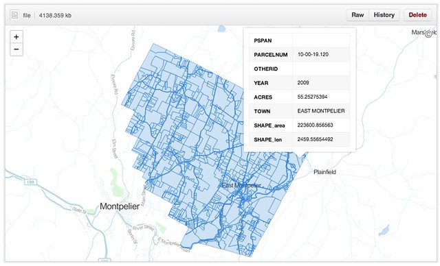

## A bolt of GIS-Manna from Heaven

A dedicated and talented GIS developer at the VT Agency of Natural Resources just finished compiling the most-comprehensive cadastral dataset to which our small state has ever had access. Coincidentally he sent out the announcement while [I was annoying a few githubbers](https://twitter.com/BenBalter/status/359323562147983363) about their new geodata capabilities. What luck: a test case.
The dataset - as a shapefile - clocks in at 250MB, representing 289,000 parcel polygons in 191 towns. [The 46 VT towns not included tend to have populations under 200 and a blithe commitment to dusty paper records.] It turns out that this is over the [100MB limit](https://github.com/blog/1533-new-file-size-limits) imposed on individual files, so I pulled the dataset, split it by town and converted the outputs to geojson, then pushed them to [a repository](https://github.com/wboykinm/vcgi) I just set up. The [largest of these](https://github.com/wboykinm/vcgi/blob/master/cadastral/vt_parcels_BURLINGTON.geojson) is juuuuust over the maximum file size to be renderable in Github's [snazzy new Mapbox-based interactive maps](https://github.com/blog/1528-there-s-a-map-for-that), but most of the town parcel maps [pop up just fine](https://github.com/wboykinm/vcgi/blob/master/cadastral/vt_parcels_WOODSTOCK.geojson).

## The Implications

Okay, great - another slippy map somewhere on the web. Who cares? These folks, actually:

- A landowner who wants to look up the parcel numbers of her abutting properties without visiting the steam pipe distribution venue in the basement of her local town hall.
- A town GIS manager who has a hard drive overflowing with parcel shapefiles, converted CAD drawings and map requests from lawyers.
- Probably a lot of lawyers. Don't get me started.
- The overworked data gurus at the [Vermont Center for Geographic Information (VCGI)](http://vcgi.vermont.gov/), who - while they're probably the only agency that can handle it - are really reluctant to take on management of a statewide, rolling, versioned database.

What Github provides in this test case, for free:

- Fast hosting of modestly-large geospatial data
- Relatively-simple [version control](http://sixrevisions.com/web-development/introductory-guide-to-git-version-control-system/) of said data
- Edit access to anyone with a github account and a GIS platform (FOSS or Arc'ed)
- An embeddable client view for the public for files up to 10MB
- A robust API for client views bigger than that ([for example](http://bl.ocks.org/wboykinm/6058712))
- A muthaflippin' download button (well, "save page as")

For those of us who have been ranting about geoportals in recent months, this pretty much covers the bases. For free. Github is walking the #opendata walk.

## What's Next . . .

There are a whole bunch of caveats here. Biggest is the file size issue (though I've seen [Bill Dollins](https://github.com/geobabbler/virtual-layers) and [Sophia Parafina](https://twitter.com/spara/status/360128986153623552) starting to work around that in the past few days), since 10MB is a fine limit for municipalities in the second-smallest state, but Manhattan is a teensy bit bigger. Another hitch is data quality; this dataset is top-of-the-line, but like any other it's missing SPAN numbers, dates and acreages here and there. The vendors will tell you that quality can't be beefed up in a free collaborative environment, without data value-add. I don't know if they're right or wrong.

But I'd love to see a town GIS manager throw a pull request and get this ball rolling. Who's up for it?
[The data hub is waiting right here](https://github.com/wboykinm/vcgi)
*Update: 7/25/13*
I've heard a bunch of awesome questions about the practicalities of using Github this way, so while I am by no means a power user [I recorded a quick demo video](http://youtu.be/GP1iBg16elo).
