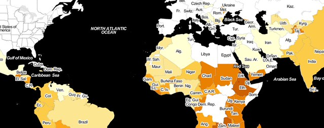
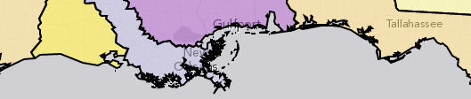

At the risk of [beating a dead horse](http://geosprocket.blogspot.com/2013/01/context-for-cheap-map-reference-overlay.html), I'm coming back to reference overlays. I've noticed that there a still a fair number of interactive maps online that permit a bullying thematic layer to stomp all over the poor, defenseless map labels and context information. This is not cool:

So I've hashed out [the code](http://wboykinm.github.io/reference) for getting past this using five common basemap services:

- [Mapbox](http://wboykinm.github.io/reference/mapbox.html)
- [Stamen](http://wboykinm.github.io/reference/stamen.html)
- [Google](http://wboykinm.github.io/reference/google.html)
- [Esri](http://wboykinm.github.io/reference/esri.html)
- [Bing](http://wboykinm.github.io/reference/bing.html)

Feel free to reuse them as you see fit. All but the Google example use Leaflet, but the z-index and canvas manipulation tactics are applicable to other APIs as well. If anyone wants to add adaptations for OpenLayers or whatnot I welcome pull requests. Also worth a note is that - in the leaflet examples - the thematic layer is rendered as vector from [topojson](https://github.com/mbostock/topojson/wiki), which is arguably the fastest vector format available to us today. Give it a shot as a thematic mapping tool.

[Go forth](http://wboykinm.github.io/reference) and bring context back to your interactive maps!

Note: Thanks to [Bobby Sudekum](https://twitter.com/bobws), [Josh Livni](https://twitter.com/jlivni) and [Jason Sanford](https://twitter.com/JCSanford) for the starting blocks.
