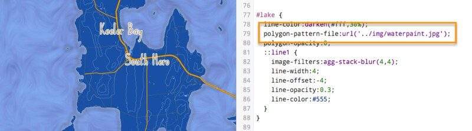

As evidenced by [AJ Ashton's announcement](https://www.mapbox.com/blog/vector-terrain-outdoors/) this week, [Tilemill](https://www.mapbox.com/tilemill/) keeps getting cooler. With [vector tiles](https://www.mapbox.com/blog/vector-tiles/) and [Tilemill 2](https://billmorris.io/shoals/gis/cartography/2013/05/19/taking-tilemill-2-for-a-spin.html) on the horizon it seems like anything will be cartographically possible, but I've been having fun while we wait.
Tilemill allows you to fill a polygon or feature with an image instead of a plain color, which makes for some cool pattern and feel options:

However, you need to be careful not to run afoul of the tiling system that repeats any such image in gridded 512px intervals. You can get some funky edges if you're not paying attention. The solution to this is to use a seamless image - i.e. an image where every edge matches up with its opposite. There are quite a few options out there for seamless backgrounds, but not very many that are both square and 512px on a side. So I followed [the lead](http://content.stamen.com/watercolor_process) of the talented artists at Stamen and reluctantly opened photoshop to make some seamless texture images of my own for Tilemill.

There are 12 of them, and [you can grab them here](http://www.flickr.com/photos/vtcraghead/sets/72157636058025184/), licensed CC-by-SA.

I'm personally inclined to overuse things like this once I've made them available (I [used them](http://liminaleditions.com/) last weekend at StoryHack, actually), so it's going to take some time before I find the right subtle level. I'll let you know when I get there.

Have fun! And I'd love to see any examples of these in the wild once you put them to use . . .

