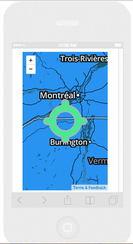
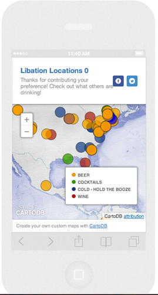

|  |
| --- |
|  |
| Find me, small screen. |

I've spent a lot of time thinking about the incredibly rich experiences we're getting these days from a digital map paradigm basically invented by Google in 2005.
A rich experience everywhere but on mobile devices, that is.
The dichotomy is pretty intense - on our larger screens, we have data visualizations of artful grandeur. We have amazing cartography in tiles and vectors, and we have smooth analytical tools. We're even [approaching "GIS on the Web"](http://geojson.io/#id=gist:wboykinm/31dc648c4260879a7bf6&map=5/22.614/80.376) that doesn't suck.
But then you turn on your phone and the best applications use oblique-angle maps the same way they did in Car SatNavs a decade ago.
I don't have an answer to this problem, I just mean to say I've been thinking about it. And it turns out that a bunch of the technologies I use regularly can be pretty easily combined to offer some possible fixes for how a user experiences maps on mobile. I'll walk you through them while trying to tackle a basic application: [a location-based survey](http://wboykinm.github.io/geosprocket-labs/forms/mobile/).

### 1.) Bootstrap

I get it. I overuse Bootstrap for the architecture of my sites. But in [the latest release](http://getbootstrap.com/) (3.0) they went "Mobile First", so it makes many of my other tasks easy by providing the responsive classes out of the box:

### 2.) Google Forms

I still think of [Google Forms](http://www.google.com/google-d-s/createforms.html) as an underutilized gem for easy data collection: pipe data from a form to [a spreadsheet with an API](https://developers.google.com/drive/); one barely needs to try anymore :) However, tying a custom Bootstrap page to a specific google form requires a few things available in the source code of the input form's page:

- Form identifiers:
- Field-specific IDs:
- A Redirection iframe:

### 3.) Mapbox.js

Most of the necessary functions here are actually native to Leaflet, but I like the look of [the Mapbox implementation](https://www.mapbox.com/mapbox.js/overview/), and they provide "Retina Tiles" that scale better for mobile. The basic tasks for the map in this application are:

- Figure out user location without asking
- Let the user fix the inevitably-incorrect positioning

This works with a quick call to a free IP registry, centering the map on the result:

Then the user can drag the map around under the crosshair to where they actually are - this is a tactic I [borrowed from OpenPlans](http://shareabouts-civicworks.dotcloud.com/page/about) after I got a reminder:

> [@mourner](https://twitter.com/mourner) [@vtcraghead](https://twitter.com/vtcraghead) an alternative would be to just let people drag the map and have the center be the target
> — tschaub (@tschaub) [November 7, 2013](https://twitter.com/tschaub/statuses/398578300999573504)

### 4.) CartoDB

Using a [new tool they've made available to sync tables](http://blog.cartodb.com/post/65639747344/create-real-time-maps-from-data-anywhere-on-the-web), there's almost no code involved in this step. All I needed to do was go to "File-->Publish" in the form target spreadsheet, then copy the .csv URL into the "New Table" creation dialog in CartoDB. Then a bit of easy styling created a custom-mapped results page:

The page itself is pretty simple, and you can [grab it as a gist here](https://gist.github.com/wboykinm/7373634). It'd be pretty easy to fork it and replace the form parameters with one of your own. As always, please share if you use it; I'd love to see where others take this.

### The Caveats and Alternatives:

- Geolocation by IP is pretty awful, unless you happen to be Google (but in that case you're [currently being sued](http://www.zdnet.com/germany-fines-google-for-unprecedented-street-view-wi-fi-data-breach-7000014337/) for the method by which you collected your registry). The service I used put me in the correct city on my laptop, the correct state on my tablet, but according to my phone I'm in Buffalo. There are [better ways](https://www.mapbox.com/mapbox.js/example/v1.0.0/geolocation/) to get location, but they require user permission, which is a UX hurdle I didn't want to jump for this.
- I subscribe to the gospel of responsive design because I'm lazy. It would probably be smoother to build this as a native Android/iOS app, but no way would it be this easy.
- Since location is being passed to the table from the initial map, there's no geocoding and you could theoretically just tap the Google Drive API to put points on a results map. But again: EASY. CartoDB is that :)

### #Facepalm

In the first run I forgot the mobile-specific meta tag. I was reminded :) Thanks, Vladimir!

> [@vtcraghead](https://twitter.com/vtcraghead) yeah, it's not marker's fault, fix the page scale with a correct meta tag :)
> — Vladimir Agafonkin (@mourner) [November 7, 2013](https://twitter.com/mourner/statuses/398591441728847872)
