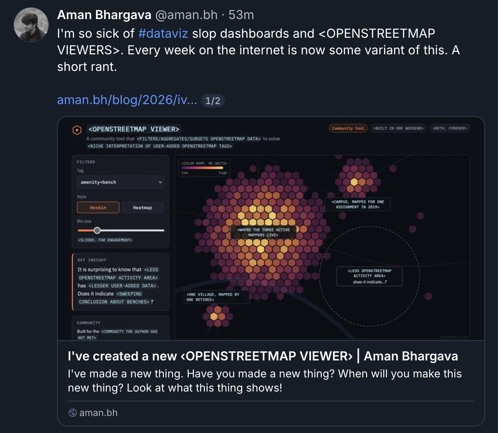
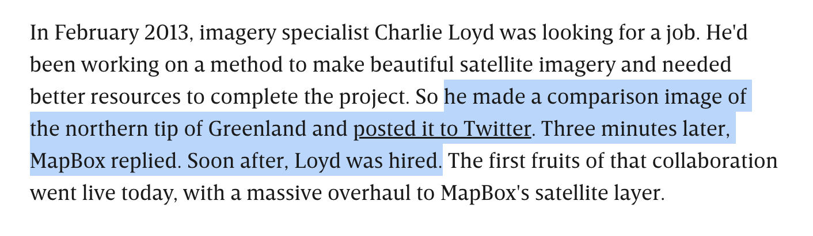

Aman Bhargava [came out guns blazing this morning](https://bsky.app/profile/aman.bh/post/3n2o5bngja22t).

Hell of [a post](https://aman.bh/blog/2026/ive-created-a-new-openstreetmap-viewer) - a madlib that boils down something I've seen all too frequently in recent months on what's left of my socials (BlueSky and LinkedIn; I know, I know). Aman's piece is perfect satire for the AI moment in data visualization:

> It is surprising to know that ‹AREA WITH FEW MAPPERS› has ‹FEW MAPPED THINGS›. Does it indicate ‹SWEEPING SOCIOECONOMIC CONCLUSION›? ‹SECOND RHETORICAL QUESTION›?

It's true! Codegen AI has hit digital cartography and data science hard, allowing sophomoric questions to be slickly validated with incorrect answers and cool graphics. The phenomenon of making crappy arguments with misinterpreted data is nothing new (paging Ed Tufte and, hell, Ellsworth Huntington for good measure), but what's changed is the volume. The bar for production has dropped through the floor. 

Now, there _is_ a prevailing wind in the month of November that may be stirring up the leaves that he's referring to. The annual [#30DayMapChallenge](https://bsky.app/hashtag/30DayMapChallenge) is now underway, and my feeds are ablaze with daily entries from a ton of eager participants. Day 3: [Polygons!](https://mapchallengegallery.squidmaps.io/day/3/) Day 12: [Power!](https://mapchallengegallery.squidmaps.io/day/12/) Interpret it however you like! If I'm being honest some of these have a distinct formulaic-ness. A . . . madlib structure. I won't call out anyone specifically here, but it's probable that a lot of entries this year are coming straight from prompts.

"Morning Claude! Please build me an interactive map centered on the city of Denver that pulls data from OpenStreetmap and USGS NED, load it in 3D with a perspective facing the mountains, then renders it in a sketch-like visual style. Also please give me a tweet-length post about it. I'm off to make coffee; want any?"

I'm not participating in the #30DayMapChallenge this year, largely because in years past it's been a huge amount of _work_. It's great work! Rewarding work! But I just started a new job this Fall, and I'm short on focus. Speaking of which, I should mention that I owe my _last_ job - at Mapbox - in no small part to [the portfolio of PostGIS queries I wrote in the course of the 2020 challenge](https://github.com/wboykinm/maptember/tree/main/2020). I wrote them all by hand! Remember that shit? It was craaaaaaaaaazy . . . and I dutifully posted the results to Twitter as I went. You see, this was a thing many of us did back in the dark ages of social media, to expand our professional presence, to gain exposure, to show off our cool work. And for a lot of us it was a decent way of [getting hired](https://www.wired.com/2013/05/a-cloudless-atlas/).

But now the cool work shared online is an AI-accelerated firehose, and I find myself tuning out. That actually feels unfair of me, like I'm pulling up the ladder of professional attention behind me now that I've used it to climb to employment. 

What are newcomers to do today to get noticed? 

_Cover image: Salar de Uyuni, Bolivia, captured by Vantor Inc._